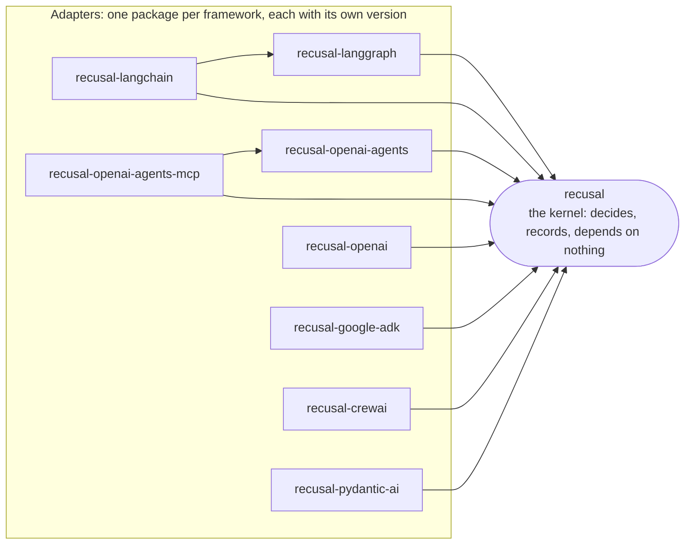

# Adapter packages

Each directory here is one installable package: the Recusal gate for one agent framework,
with that framework as its dependency and its own version. `recusal` itself depends on
none of them and has no runtime dependencies.

| Directory | Package | Requires another adapter |
|---|---|---|
| `crewai` | `recusal-crewai` | |
| `google-adk` | `recusal-google-adk` | |
| `langchain` | `recusal-langchain` | `recusal-langgraph` |
| `langgraph` | `recusal-langgraph` | |
| `openai` | `recusal-openai` | |
| `openai-agents` | `recusal-openai-agents` | |
| `openai-agents-mcp` | `recusal-openai-agents-mcp` | `recusal-openai-agents` |
| `pydantic-ai` | `recusal-pydantic-ai` | |

An arrow means "depends on". No arrow leaves the kernel.

What each one gates, and what its hook cannot see, is in its own README. How the packages
relate to the kernel is in
[`docs/ARCHITECTURE.md`](../docs/ARCHITECTURE.md#adapter-packages).

Every package ships inline types (`py.typed`). On every pull request the installed
wheel is type-checked with mypy against its framework's own types, with function
bodies checked whether or not they are annotated. Not every function is annotated, so
some of what a package returns is typed as `Any`.

**None is published to PyPI yet.** Until one is, install it from this repository, as its
README shows.

## Releasing an adapter (maintainer)

An adapter is released on its own, by its own tag, and never together with the kernel.

**Once per adapter, on PyPI.** Add a trusted publisher for the project. Before the first
release this is a *pending* publisher, created from your PyPI account's publishing page
with the project name filled in:

| Field | Value |
|---|---|
| PyPI project name | the package, for example `recusal-langgraph` |
| Owner | `philpaz` |
| Repository name | `recusal` |
| Workflow name | `release-adapter.yml` |
| Environment name | `pypi` |

A pending publisher does not reserve the name. The name is claimed by the first release.

**Each release.**

1. Set `__version__` in `adapters/<directory>/src/<module>/__init__.py`, add a changelog
   entry, and merge. Main must be green on its own run.
2. Rehearse: run the *Release an adapter* workflow by hand for that adapter. It runs the
   whole gate, builds, attests and smoke-tests, and does not sign or publish.
3. Publish a GitHub Release whose tag is `<package>-v<version>`, for example
   `recusal-langgraph-v0.1.0`, targeting the commit on main. The release workflow refuses
   a tag that names no adapter, or a version other than the one in the tree.
4. Run *Verify a published adapter release* for that adapter and version. It checks the
   published artifacts alone, with two negative controls.

**Order.** An adapter that requires another can only be installed from PyPI once the one
it requires is there. Release `recusal-langgraph` before `recusal-langchain`, and
`recusal-openai-agents` before `recusal-openai-agents-mcp`.

**What the release runs, in order, each step failing closed:**

- the full suite, lint, format and type checks at the release commit, then the adapter's
  own tests with its pinned framework installed, where none may skip;
- a hash-locked build in the reusable `build-adapter-dist.yml` workflow, which also
  installs the built wheel in a clean environment, runs the adapter's `smoke_test.py`
  from outside the checkout and type-checks the installed package, then records an SBOM
  and a build-provenance attestation;
- Sigstore signing, with the bundles attached to the GitHub Release;
- publication to PyPI by trusted publishing. A version already on PyPI is a hard failure.

The framework versions a release installs are in each adapter's `tested-with.txt`, and a
test holds them equal to the pins the pull request lane uses.

The kernel's `release.yml` ignores an adapter's tag, and `release-adapter.yml` ignores the
kernel's `vX.Y.Z` tags, so one release never triggers the other.
