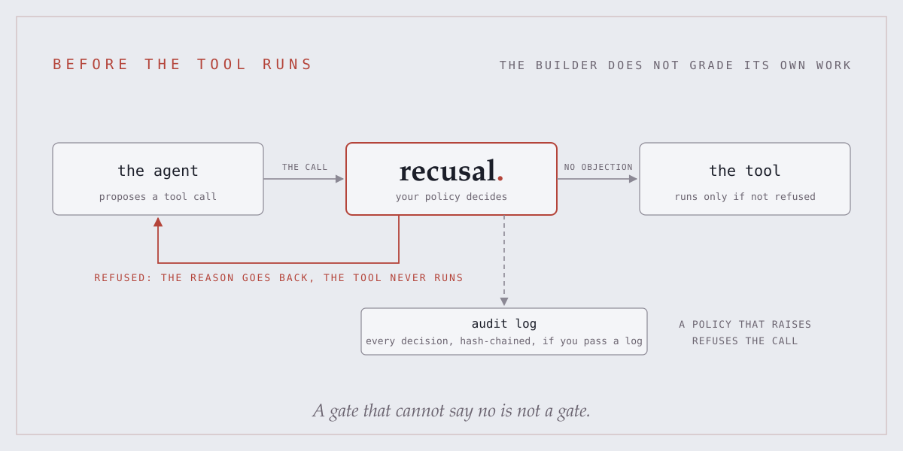

<p align="center">
  <a href="https://recusal.io">
    <picture>
      <source media="(prefers-color-scheme: dark)" srcset="https://raw.githubusercontent.com/philpaz/recusal/main/assets/banner-gate-strip.png">
      
    </picture>
  </a>
</p>

# recusal-openai-agents-mcp

[](https://recusal.io)
[](https://pypi.org/project/recusal-openai-agents-mcp/)
[](https://github.com/philpaz/recusal/actions/workflows/ci.yml)
[](https://scorecard.dev/viewer/?uri=github.com/philpaz/recusal)


The [Recusal](https://github.com/philpaz/recusal) gate for MCP tools on an
[OpenAI Agents SDK](https://openai.github.io/openai-agents-python/) agent: every call to a
local MCP server, and every hosted MCP call OpenAI asks approval for, is judged by your
policy first.

**New to Recusal?** It checks each tool call an AI agent proposes against your policy and
refuses the unsafe or unapproved ones before the tool runs. No model makes that decision.
A policy is a plain Python function: it is given the tool's name and its arguments and
returns a list of findings. An empty list lets the call run; a failing finding refuses it
and gives the reason.
[Writing a policy](https://github.com/philpaz/recusal#write-the-policy-two-postures-one-principle)
covers the two postures, allowlist and deny-list.

<p align="center">
  <picture>
    <source media="(prefers-color-scheme: dark)" srcset="https://raw.githubusercontent.com/philpaz/recusal/main/assets/gate-position.svg">
    
  </picture>
</p>

This is a separate distribution from `recusal`. The kernel has zero runtime dependencies
and a frozen compatibility perimeter; this package carries the SDK and MCP dependencies
and its own version, so a release of either never forces a release of the kernel.

It builds on
[`recusal-openai-agents`](https://github.com/philpaz/recusal/tree/main/adapters/openai-agents),
the function-tool gate, and depends on that package.

Install it from PyPI. `recusal-openai-agents`, which this package requires, comes with it:

```bash
pip install recusal-openai-agents-mcp
```

Requires Python 3.10+, `recusal>=0.15.0`, `recusal-openai-agents>=0.2.0`,
`openai-agents>=0.24.0`, `mcp>=2.3.0`, `jsonschema>=4.26.0` and `referencing>=0.37.0` (the
MCP SDK requires `jsonschema` itself, and `referencing` comes with `jsonschema`). It is
tested on every pull request against exactly `openai-agents==0.24.0` with
`openai==3.49.0`, and weekly against the newest releases.

The package ships inline types (`py.typed`) for your editor and type checker.

## Use

```python
from agents import Agent
from recusal import Finding
from recusal_openai_agents_mcp import gated_agent


def policy(tool_name, tool_input):
    sql = tool_input.get("sql", "")
    if tool_name == "run_sql" and sql.lstrip().upper().startswith("DELETE"):
        return [Finding.fail("no_deletes", severity="CRITICAL", message="DELETE is not allowed")]
    return []


agent = gated_agent(Agent(name="assistant", tools=[...], mcp_servers=[server]), policy)
```

`gated_agent` gates all three kinds of tool at once: function tools (through
`recusal-openai-agents`), every server in `mcp_servers`, and every `HostedMCPTool`.
`gate_mcp_server(server, policy)` and `gate_hosted_mcp(tool, policy)` gate one of each.

**Local MCP servers are gated in place, at `server.call_tool`.** That is the one point
where the SDK hands the server its own tool name and the arguments that are sent to it,
after any approval a person gave. A refusal returns an MCP error result carrying
Recusal's reason, and the server is never reached. The policy sees the name the server
executes under, whatever public name the model called it by, so a policy keyed by tool
name must name the server's own tools.

**The policy judges what is sent, checked against and completed from the server's listed
schema.** A server does three things with what it receives that the gate cannot watch: it
fills what the call leaves out from its defaults, it converts a value of another type
(the string `"false"` to a boolean, `"500"` to a number), and where its schema offers
several object forms it picks one by a rule of its own. The tool's listed `inputSchema` is
the only statement of what the server accepts, and it states none of those rules, so
before the policy runs the gate:

- **requires the arguments to be valid against the whole listed schema, as they stand.**
  They are validated with [`jsonschema`](https://pypi.org/project/jsonschema/), in the
  draft the schema declares (2020-12 when it declares none; draft-07 and 2019-09 are read
  too, each under its `http` or `https` address, with or without the trailing `#`):
  `anyOf`, `oneOf` and `allOf`, a `$ref` into the schema's own `$defs` or `definitions`,
  `items`, `prefixItems`, `additionalProperties`, `required`, `enum`, ranges and lengths.
  A `format` is not asserted. JSON Schema validation does not convert, so a string is not
  a boolean or a number. The gate is stricter in three places where a server would still
  convert: `5.0` is not an `integer`; an `enum` or `const` value must be of the same JSON
  type as the listed one (`1.0` and `true` are not `1`); and for `uniqueItems` two equal
  numbers are one item whatever their JSON type (`1`, `1.0` and `true`, which a Python
  set holds once). A JSON string sent for a parameter the schema types as an object or a
  list is refused like any other value of another type; the MCP Python SDK's server
  would parse it into one.
- **never evaluates a server's regular expression.** `pattern` is not checked: the server
  checks it. A pattern can take longer on a few dozen characters than any limit, and the
  text is the model's. The same holds for the names of members: under `propertyNames` a
  `pattern` is not checked, and beside `patternProperties` the gate does not work out
  which pattern a member's name matches, so every member of the object must meet the
  schema of every pattern listed there, a member `properties` does not name must also
  meet `additionalProperties` when that is a schema, and `additionalProperties: false`
  asserts nothing there (the server rejects a member no pattern matches).
- **refuses an object where the schema offers more than one object form, and a list
  where it offers more than one list form.** Two or more alternatives of an `anyOf` or
  `oneOf` that admit an object are what a `Union` of two models and a zod `z.union` of
  two objects publish. Which form runs is the server's own rule, and it is not JSON
  Schema's: a server built on Pydantic takes the member with more of the fields that are
  set and converts strings to fit it, and one built on zod takes the first member that
  parses and drops the members that one does not know, although it lists
  `additionalProperties: false`. So an object for such an argument is refused whatever
  it holds, at any depth, with one exception: where every object form fixes one
  same-named property to a `const` (or an `enum` of one value) of its own, no two the
  same, and the object carries that property with the value of exactly one form, that
  form alone is used. A list has no such tag: where two or more alternatives admit a
  list, a list is refused. One object form, or one list form, beside alternatives that
  are not one (`Optional[Model]`, `Model | str`, `list[Model] | None`) is unaffected.
- **refuses a string where the schema also admits the type a server reads its text as.**
  One rule for two readings. Pydantic's conversion reads the text of a number as the
  number and a word for a boolean (`true`, `false`, `1`, `0`, `yes`, `no`, `on`, `off`,
  `t`, `f`, `y`, `n`, in any case) as the boolean, at any depth, unless the value is
  taken as a string first: `"1700000000"` for `when: Union[int, date]` runs as the
  integer. The schema of such a parameter names `integer`, `number` or `boolean` beside
  string (a string with a `format` counts), which is what the gate can see, so there a
  string that reads as a number (anything Python's `float` accepts once the white space
  around it and its underscores are gone, `inf` and `nan` included) or as a boolean is
  refused. And the MCP Python SDK's server decodes an argument whose text is JSON for
  null, a list or an object when the parameter is not annotated exactly `str`:
  `{"scope": "null"}` for `scope: Optional[str]` runs as `None`. So for an argument
  whose schema admits another JSON type than string (an `anyOf` or a `type` list with
  `null` in it, a schema with no `type`), such text is refused. In both cases: send the
  value as JSON, not as text. A schema that admits only strings keeps every string, one
  that names no type keeps the text of a number and of a boolean (a server does not
  convert for a parameter typed `Any`), and JSON text further in than an argument is
  the string it is, which no SDK decodes.
- **writes every default the schema lists for a property the arguments leave out, at
  every depth.** The gate walks the arguments with the schema, through `$ref`,
  `properties`, `items`, `prefixItems` (in the older drafts a list of `items`, and
  `additionalItems`), `additionalProperties`, `allOf`, and the one form of an `anyOf` or
  `oneOf` that admits the object or the list there (above), and adds each property that
  is left out and has a default. The default is the property's own `default`; when its
  schema lists none itself, it is the one listed by the schema its `$ref` names, by a
  member of its `allOf` or by an alternative of its `anyOf` or `oneOf` (zod publishes
  `z.boolean().default(true).nullable()` that way), where all that are listed must be
  the same value. A default that is an object is completed in turn. The completed
  arguments are checked again, by all of the above.

The policy judges the completed arguments. They are what is sent, with one exception.

**The exception: a listed default that cannot be sent is judged, as listed, and not
sent.** There are two kinds. One that is not valid against its own property schema:
Pydantic publishes `{"default": null, "type": "string"}` for a parameter written
`q: str = None`, and the server would reject the `null` if it were sent. And one that
is text a call would be refused for sending: `mode: Optional[str] = "null"`, which the
server would decode to `None`, and the text of a number where a number is listed too.
The policy is given the default as the schema lists it (`q: None`, `mode: "null"`), the
audit entry is bound to it, and the server is sent the arguments without it. This rests
on the listing being what the server runs with when the parameter is left out. That is
so for a server built with the MCP Python SDK, which lists the default it uses. It is
not always so for one built with zod, which derives the default another way in these
cases: `z.number().default(Infinity)` lists `default: null` and runs `Infinity`;
`z.number().min(5).default(1).optional()` lists `default: 1` and runs with the parameter
absent; a `Set` or a `Map` default is listed as `{}`; and an object default that fails
its own schema is parsed again through that schema, which fills or drops members. The
gate cannot tell these listings from Pydantic's, so it judges the default as listed.

**What the gate cannot check or complete, it refuses** before the policy runs, with a
reason the model reads. The reason names the place in the arguments (`opts.recursive`,
`items[1]`), written only from property names the schema lists and positions in a list (a
key the schema does not list is written `*`), and says what the schema requires there. It
carries no argument text. Refused:

- arguments that are not valid against the schema. A value of another JSON type is told
  the types the schema declares: send the declared type, and an object as an object, not
  as JSON text. A value outside an `enum`, a `required` property left out, a member that
  `additionalProperties: false` forbids and any other constraint each say so;
- an object where the schema offers more than one object form and no tag tells which,
  and a list where it offers more than one list form (above);
- a string whose text a server reads as another type the schema also admits there
  (above);
- a schema that is not a JSON object, is not a valid JSON Schema, or declares a draft
  other than draft-07, 2019-09 and 2020-12;
- a `$ref` that does not resolve inside the listed schema itself. A remote reference is
  never fetched, and a reference to an `$anchor` is not resolved. `$dynamicRef`,
  `$recursiveRef` and a subschema with an `$id` of its own are refused too;
- a `default` listed where the gate does not read one, because it cannot tell whether
  the server would apply it: under `if`, `then`, `else`, `not`, `patternProperties`,
  `additionalProperties` beside `patternProperties`, `dependentSchemas`, `dependencies`,
  `contains`, `propertyNames`, `unevaluatedProperties`, `unevaluatedItems` and
  `contentSchema`, and under any keyword the gate does not know (a vendor's `x-shape`, a
  keyword of a later draft). `const`, `enum`, `examples`, `example` and `default` hold
  data and are not looked into;
- a property left out whose alternatives list different defaults
  (`{"anyOf": [{"type": "boolean", "default": true}, {"type": "string", "default":
  "no"}]}`), and a place two parts of the schema list different defaults for;
- a property left out whose listed default has a member its own schema does not allow.
  A Pydantic model whose fields have aliases, used as a parameter's default with
  `extra="forbid"`, lists that default under the field names and its schema under the
  aliases, so the gate cannot tell what the server would run with;
- a property left out whose listed default holds an object or a list where the schema
  offers more than one form: Pydantic runs with such a default as listed, and zod
  parses it again through the union;
- a list that leaves out an item a `prefixItems` entry lists a default for;
- a schema that leads back to itself through `$ref`, `allOf`, `anyOf`, `oneOf`, `not`,
  `if`, `then`, `else`, `dependentSchemas` or the draft-07 `dependencies` alone, with no
  value in between (`{"$ref": "#"}`), or whose defaults never settle;
- a schema that uses `unevaluatedProperties` together with `patternProperties`, which
  could be applied only by evaluating the patterns;
- arguments that cost more to check than the gate allows for their size (below);
- arguments that are not JSON data (a non-finite number such as `1e400`), or that hold a
  value more than 64 levels below the arguments object.

An argument the schema neither names nor forbids is judged and sent as it is.

The two refusals for forms and for text are also made under the keywords no default is
written through (`then`, `else`, `dependentSchemas`, `dependencies`, `patternProperties`,
`unevaluatedProperties`, `contains`, `unevaluatedItems`), whether or not the keyword
applies to the value.

A `default` is never applied where a value is always present: on the schema of the
arguments themselves (the gate always sends an object), of the items of a list and of
`additionalProperties`. JSON cannot send a member or an item without a value.

**The work is bounded by counting it, not by a timer.** A step is one keyword of the
schema applied to one value (and one more for each member or item that value holds
directly), one value visited by the walk above, one value read for a comparison (`enum`,
`const`, `uniqueItems`), or one part of the place of a validation error. Every step is
counted against an allowance of 10,000 steps and 1,000 more for every value in the
arguments (an object, a list, and each member, item and scalar in them). Nothing is
validated twice for the same schema and the same value while the arguments stand as they
are, a list or an object is walked once for a schema, and the choices of an `enum` are
read once for a call, so a recursive schema (a model with `child: Optional[Node]`), a
list of 12,000 ordinary items under `uniqueItems` and 20,000 values against an `enum`
of 600 each cost in proportion to the arguments. One exception is open: integers chosen
to share one hash make the `uniqueItems` check slow, uncounted by the allowance (10,000
such integers held the event loop for seconds). What a single step costs beyond its
count is otherwise bounded by the size of that keyword in the listed schema, and
reading a string is in proportion to its length. What the schema alone says (the types
a subschema admits, the default it lists, the forms of a union) is read once, at the
first call after each listing. The largest ordinary
calls measured spend under a twentieth of the allowance; a call over it is refused before
the policy runs, with "the arguments are too costly to check against the server's listed
schema for this tool", and is one deny entry on an audit log.

**What the rules above mean for ordinary schemas:**

- A parameter typed as a `Union` of two models, or as a zod `z.union` of two objects,
  cannot be called through the gate with an object, whatever the object holds, and
  `extra="forbid"` or `.strict()` does not change that. Give every model a `Literal` tag
  field of its own (with or without `Field(discriminator=...)`), or use
  `z.discriminatedUnion`, and have the call carry the tag; or publish one tool for each
  form. A tag field with a default must still be sent: without it the gate cannot tell
  the forms apart.
- A parameter typed `list[A] | list[B]`, or a list beside `Any`, cannot be called with a
  list. Publish `list[Union[A, B]]` with tagged members, or separate tools.
- A parameter typed `Union[int, str]`, `Union[float, str]` or `Union[bool, str]` (zod:
  `z.union([z.number(), z.string()])`) cannot be sent a string that reads as a number or
  as a boolean, although such a server would keep it a string: its schema is the same as
  that of `Union[int, date]`, for which the server converts. A `Decimal` parameter lists
  a number beside a string too: send the number.
- A `NamedTuple` or tuple parameter with a defaulted last member publishes a
  `prefixItems` entry with a default, so a call that leaves that item out is refused;
  send every item.
- A zod object publishes `additionalProperties: false` unless it is written with
  `.passthrough()`, so an argument its schema does not name is refused.
- OpenAPI's `nullable: true` is not JSON Schema: the gate reads the declared `type`, so
  `null` for `{"type": "string", "nullable": true}` is refused. A schema that means null
  lists it (`"type": ["string", "null"]`, or an `anyOf` with `{"type": "null"}`).
- A recursive model nested as deep as the 64-level limit on the arguments is completed.

To read the schema the gate also wraps the server's `list_tools`, in place. `list_tools`
returns what the server listed, unchanged, and the gate keeps each tool's schema from the
most recent listing: each listing replaces the one before, so a call to a tool the server
no longer lists is refused. A call to a tool that is not in the most recent listing makes
the gate call `list_tools()` itself, with no run context and no agent, once for that
call. A tool that is still not listed, and a server whose tools cannot be listed that
way, is refused.

A `tool_filter` hides tools from one agent; the schemas are the server's. The SDK's own
server classes keep the listing as it was fetched, before the filter (`cached_tools`),
and that whole listing is what the gate keeps. So two agents that share one server
object under a dynamic filter each reach the tools they were listed, and the gate's own
`list_tools()`, which such a filter cannot answer without an agent, still leaves it the
fetched listing. The gate does not enforce a filter: the SDK never routes a model's call
to a tool the filter hides, and a call your own code makes to one through
`server.call_tool` is judged by the policy like any other. A server class of your own
that keeps no such listing (`cached_tools` is `None`, the base class's answer) leaves
the gate with the tools of the latest listing as filtered for one agent: give each agent
its own server object there.

**A server carries one policy.** The gate is installed on the server object, so every
agent that lists that object shares it. Gating it again with the same policy is a no-op;
gating it with a different policy raises `ValueError`. Use a separate server object per
policy.

**Hosted MCP is approval-gated, not execution-gated.** Those calls run on OpenAI's
servers. `gate_hosted_mcp` returns a copy whose `require_approval` is `"always"` and
whose approval callback is Recusal's: a refusal answers `{"approve": False, "reason":
...}`, so the hosted call is not made. A hosted tool whose `require_approval` is anything
but `"always"` is reported as ungated. The policy sees the arguments as the model sent
them: the hosted server's schema is not read, so the check above does not apply.

**Build the agent completely, then gate it.** A tool or a server appended to the gated
agent afterwards is not gated, and `is_gated(agent)` then returns `False`. The gated copy
has its own `tools`, `mcp_servers` and `handoffs` lists, so a later change to the
original agent's lists does not reach it. The servers themselves are shared with the
original agent and stay gated for both. A sub-agent behind `as_tool` is accepted when it
is gated itself with this package's `gated_agent`, its own servers and hosted tools
included.

## Put every decision on the record

```python
from recusal.audit import AuditLog
from recusal_openai_agents_mcp import audited_agent

log = AuditLog(path="decisions.jsonl")
agent = audited_agent(Agent(name="assistant", mcp_servers=[server]), policy, log)
```

One log covers the three seams, each under its own surface label:

| Seam | Surface | Call id on the entry |
|---|---|---|
| Function tools | `openai_agents.tool_input_guardrail` | the SDK's tool call id |
| Local MCP server | `openai_agents.mcp.call_tool` | none: the SDK hands `call_tool` no id; the server is `control.mcp_server` |
| Hosted MCP | `openai_agents.hosted_mcp.approval` | the approval request id; the server label is `control.mcp_server` |

Each entry holds a SHA-256 fingerprint of the arguments, never the arguments. For a local
server's judged call that is the fingerprint of the arguments as judged: the arguments
sent, completed with the listed defaults, and with any listed default that is not sent
(above). A call the gate refuses before the policy runs (arguments the schema does
not allow, an object or a list the schema offers more than one form for, a string a
server may read as another value, arguments too costly to check, a schema the gate
cannot check, a tool the server does not list, arguments that are not JSON data) is one
entry too, a deny, bound to the arguments as the SDK handed them.
Arguments that are not JSON data have no fingerprint of their own, so that entry is
bound to the text the gate writes them as, under the key `input`: JSON without
spaces, a non-finite number as `nan`, `inf` or `-inf`, an object that is not data as its
type's name in angle brackets, and `...` for anything more than 64 levels down. If the
log cannot be written the call is refused. Check the log with
`recusal audit verify decisions.jsonl`.

## What the gate does not see

- **A parameter the call leaves out that has no listed default.** It is the server's to
  fill, and the schema does not say with what. Most optional parameters of hand-written
  schemas are like this, and so is every Pydantic `default_factory` default, which is not
  published. A policy that depends on such a parameter should refuse a call that leaves
  it out.
- **A server whose code does more than its schema says.** The gate guarantees what is
  sent, and that it is valid against the listed schema. What a server's own code then
  makes of a value is not in the schema. Cases seen on servers built with the official
  SDKs (`mcp` 2.3.0, and the TypeScript SDK with zod):
  - **A parameter without an annotation.** The MCP Python SDK lists `type: string` for it
    and then decodes the string as JSON, so `"null"` runs as `None` and `"[]"` as a
    list. A schema that admits only strings keeps every string, so the gate does not
    refuse these. Annotate the parameter `str`, and the server keeps the string.
  - **A type the schema leaves out.** `scope: str | SkipJsonSchema[None]` lists
    `type: string` only, and the server still decodes `"null"` and runs with `None`, for
    the same reason.
  - **A string the schema says is encoded.** A Pydantic `Json[...]` parameter lists a
    string with `contentMediaType: application/json`: the policy judges the string, and
    the server runs with what it decodes from it. `contentMediaType`, `contentEncoding`
    and `contentSchema` are not applied.
  - **A numeric string for a date.** A `format` is not asserted: `"0"` for a parameter
    typed `date` runs as 1970-01-01 and `"1700000000"` for a `datetime` as that
    timestamp.
  - **A validator or a constraint that changes the value.** A string constraint that
    strips and lowers (`StringConstraints(strip_whitespace=True, to_lower=True)`,
    `z.string().trim().toLowerCase()`) runs `"  /ETC "` as `"/etc"`. This also changes a
    default the gate wrote: Pydantic does not validate a default when the parameter is
    left out, so `name = "X "` runs as `"X "` without the gate, and as `"x"` with it,
    because the gate sent the default and the server validated what it was sent. The
    policy judged `"X "`.
  - **A fallback for a value that fails.** zod's `.catch(...)` is in no schema:
    `z.boolean().catch(undefined).or(z.null())` runs `null` as undefined.
  - **A default the server derives another way than it lists.** A listed default that
    cannot be sent is judged as listed (above): zod's `default(Infinity)`, such a
    default under `.optional()` (which runs with the parameter absent), a `Set` or `Map`
    default and an object default parsed again run as something else. So does a default
    a Pydantic model validates (`validate_default=True`).
- **An integer too large for a float parameter.** A JSON integer above 2^53 sent for a
  `number` parameter is judged as the exact integer; a server that reads the parameter as
  a float runs the nearest float.
- **Whether the server reads a member its schema does not name there.** An argument, or
  a member of an object at any depth, that the schema neither names nor forbids at that
  place is judged and sent as it is, a string that holds JSON text or the text of a
  number included: the text check reads the schema of the place, and there is none. A
  server that ignores such a member (a Pydantic model does, a zod intersection drops it)
  runs without it.
- **A schema that changes after it was listed.** The gate checks against the schema of
  the most recent listing made through the gated server object. A server that changes a
  tool between that listing and the call, and a listing the SDK serves from its cache
  (`cache_tools_list=True`), leave the gate with the older schema.
- **Request metadata.** What a server's `tool_meta_resolver` returns is sent as `_meta`
  beside the arguments. It is not given to the policy and is not in the fingerprint.
- **Hosted MCP: the server's defaults and type conversion.** The hosted server's schema
  is not read, so the policy sees the arguments as the model sent them. Which of two
  duplicate keys in the argument text the hosted server reads is not seen either: the
  policy is given the last one, as `json.loads` reads it.
- **A hosted call OpenAI does not ask approval for.** That is why the gate sets
  `require_approval` to `"always"`.
- **A hosted approval the SDK answers from its own memory.** The gate keeps no state
  between turns. When the provider repeats the id and the arguments of an approval
  request the gate already allowed, the SDK approves it again without asking the
  callback, so there are two approvals for one consultation of the policy and one entry.
  A policy that counts calls counts consultations, not approvals.
- **What the tool's own approval callback answered** after Recusal allowed a call. The
  entry records Recusal's decision, not that callback's.
- **A call the SDK rejects before `call_tool`.** Arguments for a local MCP tool that are
  malformed JSON, or not a JSON object, are rejected by the SDK itself, and the model
  reads the SDK's tool error. Arguments that hold a lone surrogate character raise
  `UnicodeEncodeError` inside the SDK and stop the run. Nothing runs and there is no
  entry.
- **Handoffs, an agent with a `prompt`, an agent whose `model_settings` put tools into the
  request, an ungated sub-agent behind `as_tool`, and `Agent` subclasses.** `gated_agent`
  raises for these at construction. A prompt stored on OpenAI's servers can configure
  tools, hosted MCP among them, that are not in the agent's `tools` list, and so can
  `model_settings.extra_body` or `extra_args` with a `tools`, `prompt`, `plugins`,
  `web_search_options` or `mcp_servers` key.
- **Model settings given to a run.** Only the agent's own `model_settings` are read when
  it is gated. `RunConfig(model_settings=...)` is merged in when a run starts, and an
  `extra_body` there is not seen.
- **Legacy `functions` definitions in `extra_body`.** A `functions` key there is sent in
  the body of the request and is not refused. It only describes functions to the model:
  the SDK runs a call by looking its name up among the agent's own tools, so a call to a
  name that is not one of them raises `ModelBehaviorError` and nothing runs, and a call
  to a name that is one passes through that tool's gate.

**Beyond the gate.** This gate judges the tool calls the framework routes through it;
the paths around it inside the framework are listed above. Like every Recusal gate, it
does not stop an agent that can reach a resource another way: a credential with wider
rights, a shell or network path outside the agent, or a file it can write that
configures the gate. Use it as one layer of several: least-privilege credentials for the
agent, a sandbox or container, limits on its network egress, and an audit anchor the
writer cannot reach ([the limits in
full](https://github.com/philpaz/recusal/blob/main/SECURITY.md#things-worth-knowing)).

## Status

**In-depth review under way.** Its fixes so far are released in 0.2.0, and the review continues. Recusal is a Beta (`0.x`) open-source project in active
development: it is not a finished or certified security product, and it is provided under
Apache-2.0 without warranty.
[What the reviews are, and where every adapter stands](https://github.com/philpaz/recusal#project-status).

**Open from the latest review round**, not yet fixed, stated so you can judge them:

- Integers chosen to share one hash, under `uniqueItems` (`set[int]`), make the check
  slow: about 10,000 of them held the event loop for seconds, uncounted by the allowance.
- Not seen: a zod server's `z.coerce` beside another type in a union reads text by
  JavaScript's rules (`"0x1F"` runs as 31); a Pydantic server converts the keys of a
  `dict[int, ...]` parameter, which the listing does not show; an integer above 2^53 on
  a TypeScript server's `integer` parameter runs rounded; a member a Pydantic server
  ignores (`field(init=False)`) or reads from elsewhere (`AliasPath`); a union a Pydantic
  server reads left to right (`union_mode='left_to_right'`).
- The refusal "Send the value as JSON, not as text" is wrong advice where the text is not
  that number (a zip code `"01234"`): the server's author should type that parameter
  `str`.

**Help make it better.** Read the code, test this adapter against your own stack and tell
us what you find. Reviews, bug reports and pull requests are all welcome:
[how to contribute](https://github.com/philpaz/recusal/blob/main/CONTRIBUTING.md), [open issues](https://github.com/philpaz/recusal/issues).
Please report a security gap [privately](https://github.com/philpaz/recusal/security/advisories/new), not in a public
issue.

## Compatibility

This package is outside the kernel's frozen perimeter (`STABILITY.md`, Integrations). Its
public names are the ones in `recusal_openai_agents_mcp.__all__`. It uses only the public
names of `recusal-openai-agents`.

A runnable offline demonstration, with an in-process MCP server and no API key, is
[`examples/openai_agents_mcp_gate.py`](https://github.com/philpaz/recusal/blob/main/examples/openai_agents_mcp_gate.py)
and
[`examples/openai_agents_mcp_audit.py`](https://github.com/philpaz/recusal/blob/main/examples/openai_agents_mcp_audit.py).

## More

<p align="center">
  <picture>
    <source media="(prefers-color-scheme: dark)" srcset="https://raw.githubusercontent.com/philpaz/recusal/main/assets/adapter-map.svg">
    
  </picture>
</p>

An arrow means "depends on". No arrow leaves the kernel, so a framework's breaking
change is answered by a release of that framework's adapter, not by a release of the
kernel.

- [Framework notes for MCP tools on the OpenAI Agents SDK](https://github.com/philpaz/recusal/blob/main/docs/FRAMEWORKS.md#openai-agents-sdk-mcp-tools):
  the detail behind this page.
- [All eight adapter packages](https://github.com/philpaz/recusal/tree/main/adapters) and
  [the kernel](https://github.com/philpaz/recusal), which has zero runtime dependencies.
- [Verifying a release](https://github.com/philpaz/recusal/blob/main/docs/VERIFY.md#adapter-packages):
  each release is built in CI, signed with Sigstore and published to PyPI by trusted
  publishing.
- [Changelog](https://github.com/philpaz/recusal/blob/main/CHANGELOG.md),
  [issues](https://github.com/philpaz/recusal/issues),
  [security policy](https://github.com/philpaz/recusal/blob/main/SECURITY.md) and
  [support](https://github.com/philpaz/recusal/blob/main/SUPPORT.md).

Licensed under Apache-2.0.
