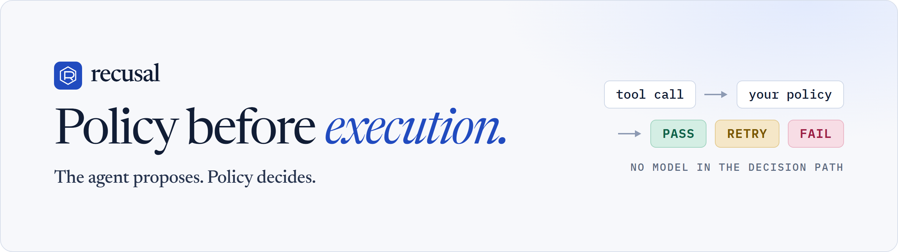

<p align="center">
  <a href="https://recusal.io">
    <picture>
      <source media="(prefers-color-scheme: dark)" srcset="https://raw.githubusercontent.com/philpaz/recusal/main/assets/banner-gate-strip.png">
      
    </picture>
  </a>
</p>

# recusal-openai-agents-mcp

[](https://recusal.io)
[](https://pypi.org/project/recusal-openai-agents-mcp/)
[](https://github.com/philpaz/recusal/actions/workflows/ci.yml)
[](https://scorecard.dev/viewer/?uri=github.com/philpaz/recusal)


The [Recusal](https://github.com/philpaz/recusal) gate for MCP tools on an
[OpenAI Agents SDK](https://openai.github.io/openai-agents-python/) agent: every call to a
local MCP server, and every hosted MCP call OpenAI asks approval for, is judged by your
policy first.

**New to Recusal?** It checks each tool call an AI agent proposes against your policy and
refuses the unsafe or unapproved ones before the tool runs. No model makes that decision.
A policy is a plain Python function: it is given the tool's name and its arguments and
returns a list of findings. An empty list lets the call run; a failing finding refuses it
and gives the reason.
[Writing a policy](https://github.com/philpaz/recusal#write-the-policy-two-postures-one-principle)
covers the two postures, allowlist and deny-list.

<p align="center">
  <picture>
    <source media="(prefers-color-scheme: dark)" srcset="https://raw.githubusercontent.com/philpaz/recusal/main/assets/gate-position.svg">
    
  </picture>
</p>

This is a separate distribution from `recusal`. The kernel has zero runtime dependencies
and a frozen compatibility perimeter; this package carries the SDK and MCP dependencies
and its own version, so a release of either never forces a release of the kernel.

It builds on
[`recusal-openai-agents`](https://github.com/philpaz/recusal/tree/main/adapters/openai-agents),
the function-tool gate, and depends on that package.

Install it from PyPI. `recusal-openai-agents`, which this package requires, comes with it:

```bash
pip install recusal-openai-agents-mcp
```

Requires Python 3.10+, `recusal>=0.14.0`, `recusal-openai-agents>=0.1.0`,
`openai-agents>=0.24.0` and `mcp>=2.3.0`. It is tested on every pull request against
exactly `openai-agents==0.24.0` with `openai==3.49.0`, and weekly against the newest
releases.

The package ships inline types (`py.typed`) for your editor and type checker.

## Use

```python
from agents import Agent
from recusal import Finding
from recusal_openai_agents_mcp import gated_agent


def policy(tool_name, tool_input):
    sql = tool_input.get("sql", "")
    if tool_name == "run_sql" and sql.lstrip().upper().startswith("DELETE"):
        return [Finding.fail("no_deletes", severity="CRITICAL", message="DELETE is not allowed")]
    return []


agent = gated_agent(Agent(name="assistant", tools=[...], mcp_servers=[server]), policy)
```

`gated_agent` gates all three kinds of tool at once: function tools (through
`recusal-openai-agents`), every server in `mcp_servers`, and every `HostedMCPTool`.
`gate_mcp_server(server, policy)` and `gate_hosted_mcp(tool, policy)` gate one of each.

**Local MCP servers are gated in place, at `server.call_tool`.** That is the one point
where the SDK hands the server its own tool name and the exact arguments it will run,
after any approval a person gave. A refusal returns an MCP error result carrying
Recusal's reason, and the server is never reached. The policy sees the name the server
executes under, whatever public name the model called it by, so a policy keyed by tool
name must name the server's own tools.

**A server carries one policy.** The gate is installed on the server object, so every
agent that lists that object shares it. Gating it again with the same policy is a no-op;
gating it with a different policy raises `ValueError`. Use a separate server object per
policy.

**Hosted MCP is approval-gated, not execution-gated.** Those calls run on OpenAI's
servers. `gate_hosted_mcp` returns a copy whose `require_approval` is `"always"` and
whose approval callback is Recusal's: a refusal answers `{"approve": False, "reason":
...}`, so the hosted call is not made. A hosted tool whose `require_approval` is anything
but `"always"` is reported as ungated.

## Put every decision on the record

```python
from recusal.audit import AuditLog
from recusal_openai_agents_mcp import audited_agent

log = AuditLog(path="decisions.jsonl")
agent = audited_agent(Agent(name="assistant", mcp_servers=[server]), policy, log)
```

One log covers the three seams, each under its own surface label:

| Seam | Surface | Call id on the entry |
|---|---|---|
| Function tools | `openai_agents.tool_input_guardrail` | the SDK's tool call id |
| Local MCP server | `openai_agents.mcp.call_tool` | none: the SDK hands `call_tool` no id; the server is `control.mcp_server` |
| Hosted MCP | `openai_agents.hosted_mcp.approval` | the approval request id; the server label is `control.mcp_server` |

Each entry holds a SHA-256 fingerprint of the arguments, never the arguments. If the log
cannot be written the call is refused. Check the log with
`recusal audit verify decisions.jsonl`.

## What the gate does not see

- **A hosted call OpenAI does not ask approval for.** That is why the gate sets
  `require_approval` to `"always"`.
- **What the tool's own approval callback answered** after Recusal allowed a call. The
  entry records Recusal's decision, not that callback's.
- **Handoffs, an ungated sub-agent behind `as_tool`, and `Agent` subclasses.**
  `gated_agent` raises for these at construction.

## Status

**In-depth review under way.** Its fixes are in [#297](https://github.com/philpaz/recusal/pull/297) and are not released yet. Recusal is a Beta (`0.x`) open-source project in active
development: it is not a finished or certified security product, and it is provided under
Apache-2.0 without warranty.
[What the reviews are, and where every adapter stands](https://github.com/philpaz/recusal#project-status).

**Help make it better.** Read the code, test this adapter against your own stack and tell
us what you find. Reviews, bug reports and pull requests are all welcome:
[how to contribute](https://github.com/philpaz/recusal/blob/main/CONTRIBUTING.md), [open issues](https://github.com/philpaz/recusal/issues).
Please report a security gap [privately](https://github.com/philpaz/recusal/security/advisories/new), not in a public
issue.

## Compatibility

This package is outside the kernel's frozen perimeter (`STABILITY.md`, Integrations). Its
public names are the ones in `recusal_openai_agents_mcp.__all__`. It uses only the public
names of `recusal-openai-agents`.

A runnable offline demonstration, with an in-process MCP server and no API key, is
[`examples/openai_agents_mcp_gate.py`](https://github.com/philpaz/recusal/blob/main/examples/openai_agents_mcp_gate.py)
and
[`examples/openai_agents_mcp_audit.py`](https://github.com/philpaz/recusal/blob/main/examples/openai_agents_mcp_audit.py).

## More

<p align="center">
  <picture>
    <source media="(prefers-color-scheme: dark)" srcset="https://raw.githubusercontent.com/philpaz/recusal/main/assets/adapter-map.svg">
    
  </picture>
</p>

An arrow means "depends on". No arrow leaves the kernel, so a framework's breaking
change is answered by a release of that framework's adapter, not by a release of the
kernel.

- [Framework notes for MCP tools on the OpenAI Agents SDK](https://github.com/philpaz/recusal/blob/main/docs/FRAMEWORKS.md#openai-agents-sdk-mcp-tools):
  the detail behind this page.
- [All eight adapter packages](https://github.com/philpaz/recusal/tree/main/adapters) and
  [the kernel](https://github.com/philpaz/recusal), which has zero runtime dependencies.
- [Verifying a release](https://github.com/philpaz/recusal/blob/main/docs/VERIFY.md#adapter-packages):
  each release is built in CI, signed with Sigstore and published to PyPI by trusted
  publishing.
- [Changelog](https://github.com/philpaz/recusal/blob/main/CHANGELOG.md),
  [issues](https://github.com/philpaz/recusal/issues),
  [security policy](https://github.com/philpaz/recusal/blob/main/SECURITY.md) and
  [support](https://github.com/philpaz/recusal/blob/main/SUPPORT.md).

Licensed under Apache-2.0.
