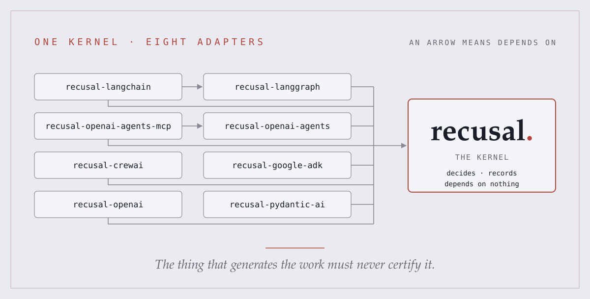

<p align="center">
  <a href="https://recusal.io">
    <picture>
      <source media="(prefers-color-scheme: dark)" srcset="https://raw.githubusercontent.com/philpaz/recusal/main/assets/banner-gate-strip.png">
      
    </picture>
  </a>
</p>

# recusal-openai

[](https://recusal.io)
[](https://pypi.org/project/recusal-openai/)
[](https://github.com/philpaz/recusal/actions/workflows/ci.yml)
[](https://scorecard.dev/viewer/?uri=github.com/philpaz/recusal)


The [Recusal](https://github.com/philpaz/recusal) gate for a loop you own on the
[OpenAI API](https://platform.openai.com/docs/api-reference): every function call the
model proposes is judged by your policy before your code runs it, and a refused call
never runs. It covers the Responses API and Chat Completions with one decision function.

**New to Recusal?** It checks each tool call an AI agent proposes against your policy and
refuses the unsafe or unapproved ones before the tool runs. No model makes that decision.
A policy is a plain Python function: it is given the tool's name and its arguments and
returns a list of findings. An empty list lets the call run; a failing finding refuses it
and gives the reason.
[Writing a policy](https://github.com/philpaz/recusal#write-the-policy-two-postures-one-principle)
covers the two postures, allowlist and deny-list.

<p align="center">
  <picture>
    <source media="(prefers-color-scheme: dark)" srcset="https://raw.githubusercontent.com/philpaz/recusal/main/assets/gate-position.svg">
    
  </picture>
</p>

This is a separate distribution from `recusal`. The kernel has zero runtime dependencies
and a frozen compatibility perimeter; this package carries the OpenAI SDK dependency and
its own version, so an SDK release never forces a release of the kernel.

Install it from PyPI:

```bash
pip install recusal-openai
```

Requires Python 3.10+ (the SDK's minimum), `recusal>=0.15.0` and `openai>=3.49.0`. It is
tested on every pull request against exactly `openai==3.49.0`, and weekly against the
newest release. The kernel floor is what checks a decorated tool: beside an older
kernel the package raises `ImportError` instead of gating without that check.

The package ships inline types (`py.typed`) for your editor and type checker.

## Use

```python
from openai import OpenAI
from recusal import Finding
from recusal_openai import gate_function_calls


def run_sql(sql: str) -> str: ...


def policy(tool_name, tool_input):
    sql = tool_input.get("sql", "")
    if tool_name == "run_sql" and sql.lstrip().upper().startswith("DELETE"):
        return [Finding.fail("no_deletes", severity="CRITICAL", message="DELETE is not allowed")]
    return []


client = OpenAI()
response = client.responses.create(model=..., input=..., tools=...)
answers = gate_function_calls(response, {"run_sql": run_sql}, policy)
# pass ``answers`` as the next request's input
```

`gate_tool_calls(completion, tools, policy)` does the same for Chat Completions and
returns `role: "tool"` messages. A completion requested with `n > 1` carries alternative
messages, so pass `choice=<list position>`; without it the gate refuses the completion
before anything runs.

Each proposed call gets exactly one answer under its own id: the tool's result, or
Recusal's reason. A policy that raises refuses the call (fail closed). The gate always
fails closed: `fail_closed` is not a keyword it takes.

The gate calls your tools synchronously, so each tool is an ordinary function. An
`async def` tool and a generator function (one whose body has a `yield`) are refused with
a reason before the policy runs, so the policy is not consulted for them. The gate reads
how a tool is declared through a `functools.partial`, a `staticmethod`, a bound method
and `functools.lru_cache`. It does not look through a wrapper of your own,
`functools.wraps` included, because such a wrapper may await or consume what it wraps:
that tool is judged and called like any other.

What a tool returns is answered as its `str`, with two exceptions. If it returns a
coroutine, the answer says so and that the gate did not run the coroutine. If it returns
a generator or any other iterator (an async generator, `iter(...)`, `map(...)`, an open
file), the answer is `` Tool `name` ran and returned a generator, which this gate does
not consume: its result is not available `` (`an iterator` or `an async generator` for
the other kinds). The function's own body ran, with whatever side effects it has, so the
answer never says the tool did not run. Return a list or a string instead.

A tool that raises: by default the exception reaches your loop, as it always has. Calls
earlier in the turn have already run and their answers are lost with it; calls later in
the turn do not run. Pass `answer_tool_errors=True` to answer the failed call instead,
with `` Tool `name` raised <ExceptionClass> `` under its own id. The class named is the
exception's nearest built-in one (`TimeoutError`, `ValueError`, `Exception` at worst):
never the message, and never a class name your application or a library chose. The rest
of the turn is then judged and run as usual, **including the calls after the failed
one**, and the traceback goes to the `recusal_openai` logger (to stderr, if your
application configures no logging), not to the model.

The gate binds the decoded arguments to the tool's signature with its defaults applied,
judges that invocation, and calls the tool with exactly those arguments. A default the
model omitted is therefore judged at the value the function would use.

## Put every decision on the record

```python
from recusal.audit import AuditLog
from recusal_openai import audited_function_calls

log = AuditLog(path="decisions.jsonl")
answers = audited_function_calls(response, tools, policy, log)
```

`audited_tool_calls` is the Chat Completions form. Each call the model proposes, run or
refused, is one hash-chained entry labeled `openai.responses.function_call` or
`openai.chat_completions.tool_call` with the API's own call id and a SHA-256 fingerprint
of the arguments (never the arguments). The call id is on the entry exactly as the API
sent it, and is at most 256 characters (see call ids below). A refusal's reason on the
log never quotes an
argument's key or value: a call that does not bind names the parameters the tool declares
and counts the arguments it does not take. A tool you have is on the entry under the
name you gave it. A name you have no tool for is the model's text: it is on the entry,
and in the reason, as sent only if it is 1 to 64 printable characters with no backtick,
and otherwise as a description of its length, such as
`<a tool name of 1000000 characters, not shown>`. If the log cannot be written the call
is refused.
Check the log with `recusal audit verify decisions.jsonl`.

The audited functions call the plain ones, so there is one decision path:
`audited_function_calls(response, tools, policy, log)` is
`gate_function_calls(response, tools, policy, audit=log, surface="openai.responses.function_call")`,
and both forms take `actor=` and `control=` for the entry. Called directly, the plain
functions also take `allow_on_pass=True`, which records a passing call as `allow`
instead of `defer` and changes nothing about what runs.

A loop whose log is optional is one call to the plain function:

```python
from recusal_openai import SURFACE_RESPONSES, gate_function_calls

maybe_log = AuditLog(path="decisions.jsonl") if recording else None
answers = gate_function_calls(response, tools, policy, audit=maybe_log, surface=SURFACE_RESPONSES)
```

`audit=None`, passed explicitly, is the plain gate: nothing is recorded, and `surface=`,
`actor=` and `control=` are accepted and not used. When `audit=` is not passed at
all, `surface=`, `actor=` or `control=` with a value raises `TypeError` before anything
is judged, so a loop that believes it is recording is never silently not recording.
`audit=` with a log and no `surface=` raises the same way. The two audited functions
need a log: `audited_function_calls(response, tools, policy, None)` raises `TypeError`
and runs nothing, because a function named "audited" that recorded nothing would
mislead.

A `surface=` or `control=` the kernel would not record raises `ValueError` naming the
keyword, before any tool call is looked at, with a log and with `audit=None`: a surface
that is empty, starts or ends with a space, is not a string or is the reserved
`claude_code.pretooluse`, and a control that is not a dict. The rule is
`recusal.decide`'s own: the gate asks it and restates nothing. `tool_use_id=` and
`fail_closed=` are not taken and raise `TypeError`: each call is recorded under its own
call id, and the gate always fails closed.

## What the gate refuses, and what it does not see

- **Refused with a reason, never run.** Each of these is answered under the call's own
  id before the policy runs, and is one entry on the audit log in the audited loop:
  - *The arguments.* Arguments that are not a string (an empty string is a call with no
    arguments), not valid JSON, or not a JSON object. `NaN`, `Infinity` and `-Infinity`
    are not JSON and are refused. So are a number Python reads as infinity (`1e999`) and
    arguments nested more than 64 levels below the arguments object.
  - *A call that is not finished.* A Responses `function_call` item whose `status` is
    anything but `completed` (`in_progress`, `incomplete`); an item with no `status`
    passes. Every function call of a response whose own `status` is anything but
    `completed` (`incomplete`, `failed`, `cancelled`, `in_progress`, `queued`, a value
    a later SDK adds), the finished items in it included; a response with no `status`
    passes. Every tool call of a Chat Completions choice whose `finish_reason` is
    anything but `stop`,
    `tool_calls` or `function_call`: that is `length` (the message was cut off at the
    token limit), `content_filter` and a missing `finish_reason`. Request the turn again
    with a higher token limit instead of running a call that may have been cut off.
  - *A namespaced function call.* A Responses `function_call` item that carries a
    non-empty `namespace` is refused: namespaced calls are not supported. The tools you
    pass and the name the policy sees are bare names, so the gate could not tell two
    functions of the same name in different namespaces apart. Declare such functions
    without a namespace, under names that are unique.
  - *The tool.* A tool the application does not have (a name that is not a string is
    one), arguments that do not bind to the tool, an `async def` tool, a generator
    function, a `functools.lru_cache` tool handed a list or an object, and a tool whose
    signature cannot be judged by name: see the next point.
- **Which tools the gate can judge.** A tool is a plain function, a bound method or a
  `functools.lru_cache` of one, whose every parameter can be passed by name
  and is annotated with a supported data type: `str`, `int`, `float`, `bool`, `Optional`
  of a supported type (also written `T | None`), `list[T]`, and `dict[str, T]`, where
  `T` is a supported type in turn (`list[dict[str, int]]` is supported). Every default
  must be JSON data. A tool cached with `functools.lru_cache` (or `functools.cache`)
  needs arguments the cache can hash: a call that hands it a list or an object, for a
  `list[T]` or `dict[str, T]` parameter or in place of a `str`, is refused with a reason
  before the policy runs. Give a cached tool `str`, `int`, `float` and `bool` parameters
  only. A cache behind a wrapper of your own is not seen: there such a call raises
  `TypeError` as any tool that raises does (see `answer_tool_errors` above). Everything
  else is refused with a reason, among them:
  - a parameter with no annotation, `Any`, `Literal[...]`, a union of two types such as
    `int | float`, a bare `list` or `dict`, an `Enum`, `Annotated[...]`, a dataclass or a
    model;
  - variadic (`*args`, `**kwargs`) and positional-only parameters;
  - a `functools.partial`, and a callable object (an instance with `__call__`) unless
    its class annotates the names `__call__` takes (a dataclass whose fields are those
    names, for example), because the kernel reads annotations from the class;
  - a `functools.wraps` wrapper that adds a parameter of its own to the function it
    wraps, and one that takes `*args, **kwargs` and also names a parameter the function
    has: either would run with a value the policy never judged.

  Whether a tool's signature can be judged is the kernel's answer. Whatever reason it
  gives, and any error it raises while reading the tool, refuses that one call before
  the policy runs.

  What to do instead: write a plain function with supported annotations and resolve
  richer types inside its body. Take a `str` and check it against the allowed values in
  place of `Literal` or an `Enum`, pick `float` in place of `int | float`, write
  `dict[str, str]` in place of `dict`, and replace a `functools.partial` or a callable
  object with a function that closes over what it needs. The annotations decide only
  whether the gate can judge the tool: the gate binds arguments by name and does not
  check or convert a value's type.
- **The tool's name in a refusal.** A refusal names a tool you have by the name you
  gave it. A name you have no tool for is quoted only if it is 1 to 64 printable
  characters with no backtick. Any other (longer, empty, or holding a backtick, a
  newline, a control or formatting character or a lone surrogate) is described by its
  length, in the answer and on the audit log, as
  `<a tool name of 70 characters, not shown>`, and a name that is not a string as
  `<a tool name that is not a string>`. So a tool name cannot close the backticks a
  refusal sets it in, start a new line, or put more than 64 characters of the model's
  text into an answer or an entry.
- **Call ids.** A call id is the model's text too, and it has to go back exactly as
  sent: in the answer, which is how the API matches it to the call, and on the audit
  entry, which is how the entry is tied to the call. So the gate does not shorten or
  describe it there. It takes a call id of at most 256 characters instead: a longer
  one raises `ValueError` before anything in the turn runs, and writes no entry. That
  bounds what one id can add to an answer or an entry at 256 characters. An id may
  hold any character; on the log it is JSON-escaped, so it cannot start a line. A
  message the gate raises (a duplicate id) quotes an id only if it is printable with
  no backtick, names at most four, and otherwise describes each by its length, as
  `<a call id of 17 characters, not shown>`.
- **Refused by raising, before anything in the turn runs:** an output item or tool call
  of a type the gate does not handle (`custom_tool_call`, the provider's record of a
  hosted tool call, a type a later SDK adds), a Chat Completions message that carries
  the legacy `function_call` field (alone or beside `tool_calls`; the gate reads
  `tool_calls` only, so declare functions with `tools`, not `functions`), a call without
  an id, a call id of more than 256 characters, a duplicate id, and a keyword argument
  the gate does not take (`TypeError` naming it, whether or not the turn has calls): a
  mistyped one, `fail_closed`, `tool_use_id`, `surface`, `actor` or `control` with a
  value when `audit` is not passed at all, and `audit` with a log and no `surface`. A
  `surface` or `control` the kernel would not record raises `ValueError` naming it. A
  turn refused this way writes no audit entry.
- **Not seen: what a wrapper does in its own body.** The gate reads signatures, not
  code. A `functools.wraps` wrapper that restates the function's parameters is judged
  by them, and if its body then does not pass one on, the function runs on its own
  default while the policy judged the model's value:

  ```python
  def logged(fn):
      @functools.wraps(fn)
      def wrapper(path: str, dry_run: bool = False):
          return fn(path)  # dry_run is not passed on

      return wrapper


  @logged
  def delete_tree(path: str, dry_run: bool = False) -> str: ...
  ```

  A call with `dry_run=true` is judged with `dry_run` true and `delete_tree` runs with
  `dry_run` false. No check of a signature can see this. Give the gate the function
  itself, or a wrapper that passes on every parameter it names.
- **Not seen by a kernel that does not detect it: a decorator applied inside another
  decorator.** The kernel follows a wrapper to what it wraps through `__wrapped__`. A
  decorator that builds a second wrapper in its closure and calls that one hides it
  from the walk:

  ```python
  def robust(fn):
      inner = with_timeout(fn)  # takes timeout= itself, does not pass it on

      @functools.wraps(fn)
      def wrapper(*args, **kwargs):
          return inner(*args, **kwargs)

      return wrapper
  ```

  With a kernel that does not detect the hidden wrapper, a tool decorated this way is
  judged and called, and a parameter the hidden wrapper keeps for itself reaches the
  function at the function's default, not at the value the policy judged. A kernel
  that detects it says so through its signature check, and the gate then refuses the
  call before the policy runs. Until then, apply each decorator at the top level,
  where the walk sees it, or give the gate the undecorated function.
- **No state between turns.** Within one turn a duplicate or empty call id raises. The
  gate remembers nothing from one turn to the next, so a call id used again in a later
  turn is not detected: each turn is judged, answered and recorded on its own.
- **No helper for streaming.** The gate takes a complete `Response` or `ChatCompletion`.
  An application that streams must assemble the complete response first (the SDK's
  stream helpers return it once the stream ends: `get_final_response()` for Responses,
  `get_final_completion()` for Chat Completions), then hand it to the gate, and must not
  run a function call from a stream event.
- **Never judged: hosted tools.** Web search, file search, code interpreter, image
  generation and remote MCP run on the provider's side. What arrives in your loop is the
  provider's record of the call (`web_search_call`, `mcp_call` and the others in
  `HOSTED_RECORD_TYPES`, which also holds `compaction`, the provider's summary of earlier
  context). By default such an item raises like any other unhandled one. Pass
  `allow_hosted_records=True` to let finished records through: they are not judged, not
  answered and not on the audit log, and the function calls beside them are judged as
  usual. A record whose `status` says it is still in progress raises either way.
- **Not gated yet: remote MCP approvals.** A remote MCP server set to require approval
  sends an `mcp_approval_request` for your loop to answer. This gate does not judge it:
  it raises, with or without `allow_hosted_records`, so the call is never approved
  through this gate.
- **Not read: `async` and `caller`.** A Responses `function_call` item can be marked
  `async` and can carry a `caller` of type `program`. The gate reads neither field: such
  a call is judged by your policy and run like any other.
- **After the decision.** An audit entry records the gate's decision, not what the tool
  then did. A call the gate allowed whose tool raised, returned a coroutine that nothing
  ran, or returned an iterator the gate did not consume, is on the log as allowed. The
  async and generator checks read how a tool is declared; a wrapper of your own that
  hides an `async def` or a generator function behind an ordinary function is caught
  only by what it returns, after the policy has allowed the call and the wrapper has
  been called.

## Status

**In-depth review complete.** Its fixes are released in 0.2.2. Recusal is a Beta (`0.x`) open-source project in active
development: it is not a finished or certified security product, and it is provided under
Apache-2.0 without warranty.
[What the reviews are, and where every adapter stands](https://github.com/philpaz/recusal#project-status).

**Help make it better.** Read the code, test this adapter against your own stack and tell
us what you find. Reviews, bug reports and pull requests are all welcome:
[how to contribute](https://github.com/philpaz/recusal/blob/main/CONTRIBUTING.md), [open issues](https://github.com/philpaz/recusal/issues).
Please report a security gap [privately](https://github.com/philpaz/recusal/security/advisories/new), not in a public
issue.

## Compatibility

This package is outside the kernel's frozen perimeter (`STABILITY.md`, Integrations). Its
public names are the ones in `recusal_openai.__all__`. When an SDK release changes the
response types the gate reads, this package gets a release and the kernel does not.

A runnable offline demonstration, with SDK-validated responses and no API key, is
[`examples/openai_responses_gate.py`](https://github.com/philpaz/recusal/blob/main/examples/openai_responses_gate.py)
and
[`examples/openai_responses_audit.py`](https://github.com/philpaz/recusal/blob/main/examples/openai_responses_audit.py).

## More

<p align="center">
  <picture>
    <source media="(prefers-color-scheme: dark)" srcset="https://raw.githubusercontent.com/philpaz/recusal/main/assets/adapter-map.svg">
    
  </picture>
</p>

An arrow means "depends on". No arrow leaves the kernel, so a framework's breaking
change is answered by a release of that framework's adapter, not by a release of the
kernel.

- [Framework notes for the OpenAI API](https://github.com/philpaz/recusal/blob/main/docs/FRAMEWORKS.md#openai-api-your-own-loop):
  the detail behind this page.
- [All eight adapter packages](https://github.com/philpaz/recusal/tree/main/adapters) and
  [the kernel](https://github.com/philpaz/recusal), which has zero runtime dependencies.
- [Verifying a release](https://github.com/philpaz/recusal/blob/main/docs/VERIFY.md#adapter-packages):
  each release is built in CI, signed with Sigstore and published to PyPI by trusted
  publishing.
- [Changelog](https://github.com/philpaz/recusal/blob/main/CHANGELOG.md),
  [issues](https://github.com/philpaz/recusal/issues),
  [security policy](https://github.com/philpaz/recusal/blob/main/SECURITY.md) and
  [support](https://github.com/philpaz/recusal/blob/main/SUPPORT.md).

Licensed under Apache-2.0.
