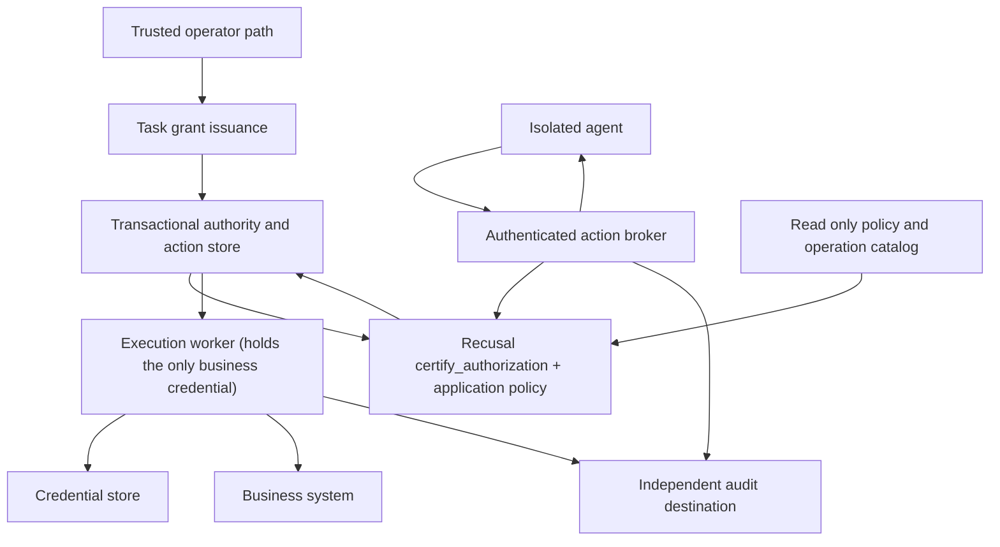

# Reference architecture: an isolated enterprise deployment of Recusal

**This is a reference architecture, and a position.** It describes a way to deploy
Recusal inside an enterprise so that an agent can perform one narrowly authorized
business operation while the surrounding system, not the agent and not the model, holds
every credential and every decision. Recusal is looking at building this out. Nothing in
it is built, deployed or independently validated today, and nothing here is a claim
about the library beyond what its source says. Each statement about the library is
checked against the commit named in section 12; each statement about the deployment is
the design we would build, and section 10 says what would make it the wrong design.

Who this is for: the platform, security and risk owners who have to decide whether an
agent may act on a system of record, and the engineers who would build the deployment
around it. Read it with the repository checked out; every library reference names the
module and function to open.

## 1 The problem this design isolates

An agent that can act on a business system carries four risks that a policy check inside
the agent process cannot remove on its own:

1. **Direct access.** If the agent's process holds the bank credential, a prompt injection
   or a bug in the agent can use it without any gate.
2. **Enforcement tampering.** If the gate runs where the agent runs, whatever compromises
   the agent can skip, alter, or starve the gate, or edit the policy it reads. Section
   4.3 is the answer to "can the AI change the JSON to allow it", and section 4.4 to
   "can the AI change the code that enforces it".
3. **Replay and over-spend.** A valid action repeated, or a budget observed by two callers
   at once, executes more than was authorized.
4. **Uncertain outcomes.** A request reached the business system and the response was
   lost. Retrying blindly duplicates the mutation; never retrying loses it.

Recusal answers the question "is this agent authorized for this exact action?" as a pure
function of supplied evidence. It states, in its own module docstring, what it does not
do: it does not establish identity, does not issue delegation, does not read a clock,
keep a counter or hold a nonce set, and does not sign
(`recusal/authorization.py`, module docstring, "What this module does not do"). Those
are the exact gaps an enterprise deployment has to fill. This document is the shape of
the filling.

## 2 The shape in one paragraph

**One operation to follow through the document.** A customer-service agent is asked to
change a member's mailing address. An operator has already issued the agent a task
grant: this tenant, this one customer, two operations (`customer.read_summary` and
`customer.update_mailing_address`), the four address fields, an independently approved
new address and expected customer-record version, an expiry one hour out, and a budget
of three actions. The operator obtains the new values through a trusted application
form or protected operator path; an agent's assertion or summary is not that approval.
The agent proposes the update to the broker. The broker checks that the caller is the
identity the grant was issued to, that the target is the grant's
customer, that the address and record precondition exactly match the approved intent,
that the grant is live and has budget, and that its policy epoch and digests match the
shared active-policy record as well as the process's loaded artifacts. It writes the
prepared action, consumes a nonce and one budget unit in one database
transaction, and waits for the audit destination to acknowledge. The executor, the only
process holding the core-system credential, claims the action, rechecks the grant, and
sends exactly the approved payload with an idempotency key derived from the action ID
and an immutable acceptance deadline enforced by the synthetic target.
If the response is lost, the action is marked outcome unknown and looked up by that key
before anyone retries. If the agent instead proposes a balance change, a different
customer, an unapproved but well-formed address, or a policy edit, the refusal happens
at the broker and nothing reaches the core system. Every section below is that story
in detail.

The agent never touches the business system. It talks to an **action broker** that
authenticates the caller, binds the call to a pre-issued **task grant**, has Recusal and
the application policy judge the exact action, and, only if authorized, persists an
**immutable prepared action** in a transaction that also consumes a replay nonce and
reserves one unit of budget. Nothing executes until an **independent audit destination**
acknowledges the intent. A separate **execution worker**, the only identity that holds
the business credential, claims the action inside a locked transaction that rechecks
eligibility, calls the business system with an idempotency key, and records the outcome,
including the honest state **outcome unknown**, which is reconciled before any retry.
Duplicate-free retry requires target-enforced idempotency with payload binding, or
definitive evidence that the prior attempt did not apply and cannot apply later. An
outcome lookup helps reconciliation, but "not found" alone is insufficient: the original
request may still be processing. Without either protection, the action remains outcome
unknown for operator reconciliation, and no duplicate-free retry claim is made.

### 2.1 The path from a checkout to an enterprise deployment

What you need to have, and the order in which the pieces stand up. Each step is proven
before the next; sections 5 to 9 give the detail behind each.

| Step | You stand up | It must prove before you continue |
| --- | --- | --- |
| 1 | **The library, pinned.** Install the Recusal wheel by version and sha256 digest. Wire `certify_authorization` the way [`HOWTO.md`](HOWTO.md) section 8 shows, feeding every dimension from the sources in section 4.1 | A refusing dimension produces no executable action; a missing dimension refuses |
| 2 | **An identity provider and a grant issuer.** Workload identities for agent, broker, executor and issuer; a protected operator command that issues task grants bound to an authenticated user, one customer and independently approved update values | Another caller's grant, a forged or expired token, and a well-formed but unapproved address are refused |
| 3 | **PostgreSQL with roles.** Tables for grants, nonces, idempotency records, actions, the outbox and a shared active-policy record; a role per process; the executor's role may update only state, claim, dispatch and outcome columns | Concurrent proposals cannot exceed the budget; an altered stored action cannot execute; old replicas cannot authorize or claim under a superseded policy epoch |
| 4 | **The broker.** Authenticates, binds caller to grant, judges with Recusal and application policy, and persists the prepared action, nonce consumption, budget decrement and audit event in one transaction | Sections 6.1 and 9: A01 to A12 pass |
| 5 | **An independent audit destination.** A store the agent and broker identities cannot administer, that acknowledges durable receipt and deduplicates event IDs, fed only through the outbox relay (section 4.2) | No action reaches `READY` without acknowledgement; A17 and A18 pass |
| 6 | **The executor and the secret store.** The only identity holding the business credential, delivered to it alone; the claim transaction of section 6.3; a connector with fixed destination and an idempotency key derived from the action ID | A19, A20, A22, A30 pass; the credential is unreachable from the agent |
| 7 | **Network isolation.** Private endpoints for the business system, database and secrets; agent egress limited to the broker and any approved model endpoint | A13, A14, A28 pass with negative reachability tests |
| 8 | **One cloud deployment as reviewable code.** The same roles, rules and tests on the chosen cloud, with monitoring and runbooks from section 8 | Every scenario passes in the cloud with deployment evidence; a separate operator reproduces it from the documentation |

Steps 1 to 6 can be stood up locally in containers with a synthetic business system,
which is the first functional checkpoint in section 11. Steps 7 and 8 are where the
isolation claim is earned, and no isolation is claimed before them.

## 3 Who may reach what

| Actor | May reach | May not reach |
| --- | --- | --- |
| Agent | Broker API; an approved model endpoint if one is used | Business system, database, secrets, audit administration, deployment controls |
| Broker | Identity validation, scoped grant and action transactions, audit append | Business credentials; grant issuance under its runtime role |
| Executor | Approved persisted actions, guarded state transitions, a target-restricted business credential, audit append | Creating grants, changing approved arguments, deploying policy, target operations outside the credential's documented scope |
| Grant issuer | Creating and revoking narrow grants through a protected operator path | Agent or broker runtime impersonation |
| Deployment identity | Reviewed release artifacts, configuration and protected policy activation | Use by the running agent |
| Audit reader | Reading evidence by role | Altering retained records |

The attacker model includes hostile prompts, hostile tool arguments, repeated and
concurrent calls, and arbitrary code execution inside the agent sandbox. It excludes
compromise of the cloud administrator, the host kernel, the deployment identity, the
identity provider, or the broker and executor runtimes. A validation report names these
exclusions every time.

The broker, executor, grant issuer and authority database are trusted components. The
agent can send hostile requests to the broker API; parser, authentication, tenant
binding and policy defects remain subjects of testing. The runtime-compromise exclusion
does not establish resistance to those defects. If an attacker takes over a trusted
runtime, read-only images and receipts do not stop it from abusing its existing powers.
Section 7.1 records the executor credential's target-enforced limits and residual blast
radius; runtime-compromise containment is not a claim of this reference.

## 4 What decides what

Three layers decide, and every decision record names which one refused. Nothing is
attributed to Recusal that the application or the infrastructure actually enforces.

| Layer | Decides | Evidence |
| --- | --- | --- |
| Recusal | Whether each of the nine dimensions is satisfied by the context the broker supplies, and whether the business policy allows the exact action fingerprint | One `Finding` per dimension, an `AuthorizationDecision`, a `DecisionReceipt` |
| Application | Tenant, customer, exact approved update values and record precondition, value-shape and read-response checks; caller-to-grant binding; active-policy epoch; atomic reservation; nonce uniqueness; eligibility at dispatch | Sanitized decision event, state transitions, outbox rows |
| Infrastructure | Who can reach what, who can write which column, which identity holds which credential | Deployment configuration, negative reachability tests |

### 4.1 What Recusal verifies, from the source

Every dimension is mandatory. `certify_authorization` runs the built-in checks and
applies the same synthesis `certify_dimensions` exposes: a failed CRITICAL
`authorization.dimension_missing` for any dimension without a finding, so no request
passes for lack of a finding (`recusal/authorization.py`, `DIMENSIONS`,
`certify_dimensions`, `certify_authorization`). Read the distinction carefully: an
undeclared constraint is not a missing finding. A grant with no `expires_at`, no
`max_calls`, no field allowlist, or no manifest digest on either side passes the
corresponding check with a finding that says so, "stated, not inferred". That is why
the application's bounded-grant check, which refuses any grant missing those
declarations (A07), is mandatory and is attributed to the application, not to Recusal.
The nine, with what each check actually does and therefore what the deployment must feed
it:

| Dimension | What the check does (source) | What the deployment supplies |
| --- | --- | --- |
| `principal` | Passes only if `trusted_principals` maps the request's label to a configured principal; no rule, refuse (`check_principal`) | The mapping from the authenticated workload identity to the grant's principal. The label comes from the identity token, never from the proposal body |
| `subject` | The action's `resource` must equal `active_subject`; no resource, refuse (`check_subject`) | The grant's customer as the active subject; the proposal's target must match it |
| `tool_operation` | Tool and operation must appear in `allowed_operations` (`check_tool_operation`) | The grant's operation list, drawn from the read-only catalog |
| `arguments` | Arguments must satisfy the supplied `Constraints`: a top-level field allowlist and one numeric upper bound on one argument (`check_arguments`, `Constraints`) | The allowed fields recorded on the grant. Nested-field, value-shape and exact approved-intent comparisons are the application's (A05, A36) |
| `expiry` | When `expires_at` is declared, `now` must be before it; both must be timezone-aware ISO 8601, and a missing `now` then refuses (`check_expiry`) | Fresh PostgreSQL `clock_timestamp()` sampled after acquiring the required locks, with a final guarded time check before reservation or dispatch-state update (section 6.7). The application refuses a grant with no expiry (A07) |
| `budget` | Refuses when the supplied `calls_so_far` is at or above `max_calls` ("call budget exhausted: N of M already spent"); the docstring says it "does not reserve a slot, so concurrent callers observing the same count can each pass" (`check_budget`) | `calls_so_far` is the count already reserved: original budget minus remaining reservations, read under the grant row lock before this action is reserved. The atomic decrement happens in the same transaction |
| `replay` | The request's `nonce` must not be in `used_nonces`; "verified, not reserved" (`check_replay`) | A server-issued single-use nonce, its consumption written in the same transaction, uniqueness enforced by the database |
| `policy_binding` | `approval.policy_version` must equal the current `policy_version` (`check_policy_binding`) | The grant's approved policy digest compared to the shared active-policy digest. The application separately requires the grant's epoch and loaded artifact digests to match the active record (section 6.6) |
| `manifest_binding` | Both sides absent passes "stated, not inferred"; one side present refuses; both present must be equal 64-hex sha256 (`check_manifest_binding`) | The grant's approved catalog digest compared to the shared active catalog digest; the loaded catalog must also match. This is application configuration, not evidence of MCP server integrity; a later MCP transport requires its own validation |

Two further library facts the design relies on:

- **The action fingerprint binds principal label, tool, operation, resource, arguments
  and nonce** (`ActionRequest.action_fingerprint`, `to_dict`). The stored action's
  fingerprint is recomputed at dispatch and must match.
- **The receipt is derived, not described.** `DecisionReceipt.build` takes the decision
  for everything adjudicated; the caller may add only an audit anchor and a timestamp.
  So no caller can label a receipt with a policy or manifest the decision was not made
  under, and `verify` re-folds the findings and requires equality (module docstring, "A
  receipt is derived, not described"; `DecisionReceipt.build` signature).

### 4.2 What the audit module offers and what it does not

`recusal.audit` is a hash chain with a `prev_hash` per entry and a genesis of 64 zeros
(`recusal/audit.py`, `GENESIS`). The module calls itself "tamper-evident, not
tamper-proof" and names the countermeasure: an `AuditSink` that receives each committed
entry in chain order, where "a sink signals failure by raising", the append then fails
closed, and "a sink must tolerate a seq gap" because a retry appends a new entry
(`AuditSink` docstring). The module also states that "the log contains what you put in
it": finding messages, verdict reasons and exception text are stored in plaintext, and
since 0.14.0 `safe_errors=True` on the tool-call evaluator records a stable code and the
exception's class in place of that text.

The design therefore uses one delivery path to the external destination, and it is not
a synchronous sink. The outbox table (section 6.1 step 7) is the only route by which
events reach the independent audit destination, and the destination's acknowledgement
of that action's authorization-intent event is required for the conditional
`PENDING_AUDIT` to `READY` transition (section 6.2). A Recusal
chain, if the broker keeps one, is a local record written after the database commit,
never inside it, and its head anchor `(seq + 1, hash)` is itself delivered through the
outbox so the external destination can verify the local chain. Two acknowledgement
paths, or a network call while the grant row is locked, are the failure modes this rule
exists to prevent. Payloads stay out of messages.

### 4.3 The agent cannot change the rules

The question a risk owner asks first: can the AI change the policy to allow what it
wants? In this design the answer is no, and the answer is a property of the deployment,
not of the model's good behaviour. Six complementary controls; the first four each
remove a route, the last two make any change refuse and make it visible:

| Control | What it prevents | Where it is enforced |
| --- | --- | --- |
| **The agent has no operation that touches policy.** The operation catalog names business operations only. There is no `policy.update`, no `grant.issue`, no `budget.raise`. A proposal naming any such operation is refused at `tool_operation` because it is not in the grant's allowed operations | Asking nicely | Catalog, section 5.3; Recusal `check_tool_operation` |
| **The agent has no path to the policy files.** `policy.json` and `tool-catalog.json` are deployed, read-only artifacts inside the broker and executor images. The agent's only network route is the broker API. It has no filesystem, volume, socket or credential that reaches them | Editing the JSON | Network rules and read-only artifacts, section 7; A13, A14 |
| **The broker and executor cannot write policy either.** Their runtime identities have no write permission on the artifacts or the deployment. Compromise of those runtimes is outside the attacker model (section 3); this control is about least privilege, so that a bug in one process is not a write path to the rules | A defect in one process becoming a policy change | Deployment roles, section 3 |
| **Policy changes go through the deployment identity alone**, as a reviewed release: a pull request, a review, a new image digest, a new policy digest. That identity is never available to the running agent, broker or executor | A silent change by anyone with runtime access | Section 3; attacker model excludes the deployment identity and says so |
| **Activation makes earlier grants ineligible for new authorization and dispatch.** Each grant and action records a policy epoch and policy/catalog digests. Transactions compare them and the loaded artifacts to the shared active-policy record, never just to a replica's own files. Recusal compares the approved and active digests; the application checks the epoch. Activation serializes with authorization and dispatch (section 6.6); rollback uses a new epoch so old grants cannot revive. Already committed dispatches are treated separately | An old replica continuing to use superseded authority | Recusal plus application transactions, sections 4.1 and 6.6; A15, A33, A37 |
| **Every policy activation is audited.** Each authorization and dispatch event carries the epoch and policy/catalog digests in force, and the receipt's policy and manifest come from its decision (`DecisionReceipt.build`). Activation records go through the outbox to a destination the runtime identities cannot administer | Concealing a policy cutover or rollback | Section 8; A25, A37 |

The same six controls cover the other ways an agent might try to widen its own
authority: it cannot issue itself a grant (the issuer is a protected operator path with
no agent-facing API), it cannot raise its own budget (the budget lives on the grant row
and only the broker's transaction decrements it), it cannot extend its own expiry, and
it cannot mint a nonce (the broker issues them).

What this does not cover, stated plainly: a human holding the deployment identity can
change policy. That is the intended path, it is reviewed, and it leaves a digest trail.
The attacker model in section 3 excludes compromise of that identity, and the validation
report says so every time.

### 4.4 The agent cannot touch the gate's own code

One layer below the policy is the code that reads it: the Recusal package, the broker
that calls `certify_authorization`, and, where one is used, the `PreToolUse` hook or
framework interceptor that runs beside the agent. A policy nobody can edit is worthless
if the interpreter of that policy can be replaced, shadowed or uninstalled. The design
answers this differently for the two places gate code can run, and the difference is
the reason the broker exists.

**Where the gate decides: the broker, out of the agent's reach.** In this design the
code that governs the agent does not run on the agent's machine at all. The agent can
call the broker API, but cannot administer or modify the broker and executor images
through a filesystem, volume, runtime socket or deployment credential (section 3).
Artifact identity is established before those images run; runtime security still depends
on the trusted components and deployment controls:

| Control | What it establishes | Source |
| --- | --- | --- |
| The Recusal wheel is installed by version and sha256 digest, and the digest is in every validation report | The code in the image is the code that was reviewed | Section 2.1 step 1; section 11 |
| Release artifacts are built in CI with build-provenance attestation and Sigstore signing; publish fails closed behind signing | The wheel came from the repository's own release workflow at a named commit | [`SECURITY.md`](../SECURITY.md), "Supply chain (CI)"; [`VERIFY.md`](VERIFY.md) |
| Broker and executor images are pinned by digest, their filesystems are read-only, and their runtime identities cannot write to their own artifacts or redeploy | Runtime roles cannot persistently replace the deployed artifacts; this does not prevent an already compromised process from misusing its current powers | Section 7; A14 |
| Only the deployment identity changes an image, through a reviewed release, and that identity is never available to any running process | Changing the gate code is a human act, reviewed, with a digest trail | Section 3; section 4.3 |

So in this architecture the question "can the AI edit the `.py` that governs it" has the
same answer as "can the AI edit the policy": it has no route to the bytes, and the bytes
are digest-pinned so a change would be visible.

**Where a hook runs beside the agent: defence in depth, not the boundary.** An
enterprise may also run the Claude Code hook or a framework interceptor inside the
agent's own sandbox, for example to stop a destructive shell command before it ever
becomes a proposal. That code shares a machine with the agent, so it is defended, not
isolated. What the repository does today for its own hook, verbatim from its sources:

- The hook refuses edits and deletions of its own kill-switch, the settings and hook
  scripts, the in-repo enforcement package it imports, the git hooks path, and the
  control directories themselves, via `Write` and `Edit`, via `Bash` including
  redirects and inline-script writes, and via any other non-read tool whose inputs
  reference a protected path, matched against the de-obfuscated command
  ([`SECURITY.md`](../SECURITY.md), "Disabling the gate itself"; pinned across
  `tests/test_dogfood.py`, `tests/test_dogfood_redteam.py` and
  `tests/test_subversion_hook.py`).
- It refuses package-manager commands that uninstall, reinstall or shadow the
  enforcement package ([`PROVEN.md`](PROVEN.md), verbatim hook output: "refusing a
  package-manager command that uninstalls, reinstalls, or shadows the gate's
  enforcement package (recusal); manage it outside the governed session").
- The hook script appends rather than prepends the repository to its import path, so a
  file planted at the repository root such as `hashlib.py` cannot shadow the standard
  library (`.claude/hooks/recusal_gate.py`, the comment above its `sys.path` handling).
  The guard covers the repository only: `SECURITY.md` states that `site-packages`,
  user-site, `.pth` files and a trojaned `recusal` distribution are outside the hook's
  control-path guard, and an actor who can write there controls the gate.
- An adopter who installs Recusal into site-packages keeps the enforcement code outside
  the governed tree ([`SECURITY.md`](../SECURITY.md), same row), which moves the
  question to who can write to site-packages on that machine.

And the limits the repository states for that mode, which are the reason it is not the
boundary here: these are deny-list controls with the deny-list caveat; a bare
interpreter may run a file; and a hook that exceeds its timeout is fail-open unless the
registration sets `"onFailure": "block"` on Claude Code 2.1.295 or later, which the
repository's `init` writes and its plugin carries ([`SECURITY.md`](../SECURITY.md),
"Hook timeout is fail-open unless the registration and the Claude Code version both
close it"). The enterprise controls that would harden this mode, managed-hook
distribution, `allowManagedHooksOnly` with a force-enabled managed plugin, and
native-deny precedence, are documented by Claude Code and written up in
[`SECURITY.md`](../SECURITY.md) as the one validation still open: procedures that have
not been executed in a real managed deployment. This design does
not close that validation and does not depend on it: an agent that defeats its local
hook still has nothing but the broker API, and the broker judges again, on its own
code, from its own image.

**The position in one line.** Code the agent can reach is defended. Code the agent
cannot reach decides. The deployment puts the deciding code where the agent cannot
reach it, and proves what that code is by digest before it runs.

## 5 Contracts

### 5.1 Agent proposal

A grant reference, an operation, a target reference, operation-specific arguments, the
expected target record version for an update, an idempotency key, and a replay nonce
the broker issued to this caller for this grant (section 5.2). Extra fields, invalid
values, excessive sizes, duplicate JSON keys,
non-finite numbers and unsupported types are rejected before anything is fingerprinted.
Recusal's own canonicalization also rejects sets, non-string keys, NaN and infinities
with `ValueError` rather than normalizing them (module docstring, "Malformed evidence is
rejected, never normalized"); the application rejects first so the model never sees that
text.

A grant ID is a reference, not a credential. The broker verifies that the authenticated
caller and the delegated user are bound to it. Caller-supplied identity, tenant, clock,
counters, policy versions or audit status are never authority.

### 5.2 Idempotency key and replay nonce are two values

| Value | Issued by | Unique within | Lifetime | Purpose |
| --- | --- | --- | --- | --- |
| Idempotency key | The agent, one per intended business action | The grant | The grant | A retry of the same intended action returns the same prepared action; the same key with different content is refused |
| Replay nonce | The broker, handed to the authenticated caller ahead of a proposal (with the grant status response), bound to the grant and tenant | The grant | Short, configured, expires unused | Presented by the agent in the proposal and consumed in the authorization transaction. Fills Recusal's `replay` dimension: a captured proposal replayed, or a nonce used twice, refuses at `replay` and at the uniqueness constraint |

The nonce is presented by the agent, not minted inside the transaction. A nonce the
broker minted for itself and then checked against its own use-state would always pass
and would protect nothing; the control has teeth only because the token crosses the
agent boundary and comes back.

**Two fingerprints.** Recusal's action fingerprint binds principal label, tool,
operation, resource, arguments and nonce (`ActionRequest.to_dict`), so it changes with
every nonce and cannot be the retry comparison. The broker therefore keeps both:

| Fingerprint | Over | Used for |
| --- | --- | --- |
| Intent fingerprint | Operation, target reference, canonical arguments and expected target record version (explicitly null for a read) | Compared to the independently approved intent for an update and used for idempotency in section 6.1 step 3; same key and different intent refuses |
| Recusal action fingerprint | Principal label, tool, operation, resource, arguments and consumed nonce, exactly as `ActionRequest.to_dict` defines | Stored on the action and recomputed at dispatch; the application's intent comparison separately binds the target record precondition |

A retry carries the original idempotency key; whatever nonce it carries is ignored
because step 3 returns the existing action before any nonce is examined. A new intended
action needs a fresh nonce. Both values have database uniqueness constraints:
`(grant_id, idempotency_key)` and `(grant_id, nonce)`.

**The business system's idempotency key is not the agent's.** The agent's key is unique
only within one grant, so two grants could present the same string to the business
system. The connector derives the downstream key from the server-generated action ID,
which is unique across the deployment.

### 5.3 Task grant

Issuer, tenant, authenticated workload and user binding, customer, allowed operations,
allowed input and output fields, expiry, finite call budget, the policy epoch and
policy/catalog digests it was approved under, a version, and revocation state. An update
grant also carries an immutable approved-intent record: exact canonical new address
values, expected target record version, its intent fingerprint, approving operator or
user reference, approval time and trusted source reference. These values are sensitive
and receive the same storage and access protection as prepared arguments.

The protected issuer records that intent from an independently authenticated application
form or operator path. It never treats an agent-supplied `approved` flag, explanation,
prompt, or model-generated summary as approval. The application compares the proposed
intent to this record before authorization and again at dispatch. An address with valid
syntax and allowed field names still refuses if its values or precondition differ
(A36). Changing either requires a new approval and grant; the executor cannot normalize
or repair them silently. Any canonicalization used for comparison is specified by the
contract and also used in the trusted approval preview.

The first workflow does not delegate arbitrary address selection. This comparison
establishes agreement with the recorded approval, not that the human's address is true
or that the trusted approval channel was free of deception. Incorrect trusted input and
misuse by the issuer remain risks. A future broader delegation must explicitly accept
the risk of harmful actions inside its allowed scope; passing field checks alone is not
evidence of the user's intended outcome. This follows the exact-action approval
principle in the [OWASP action-integrity guidance](https://cheatsheetseries.owasp.org/cheatsheets/AI_Agent_Security_Cheat_Sheet.html#high-impact-action-integrity-controls).

The budget counts reserved authorized actions, not successful outcomes. A failed or
canceled action does not refund automatically. A retry reuses its reservation; a new
action needs a new one.

### 5.4 Prepared action

A server-generated, 128-bit random action ID (making guessing impractical), grant and
tenant references, immutable operation and arguments, the intent
fingerprint and the Recusal action fingerprint, the policy epoch and policy/catalog
digests, authenticated context and approved-intent references, the expected target
record version where applicable, the immutable target acceptance deadline `not_after`,
the idempotency key, the consumed nonce, the authorization decision, and execution state.
The deadline is no later than the grant expiry; the synthetic target enforces it as
described in section 6.7. At dispatch, the application also recomputes the intent
fingerprint and compares it and the precondition with the grant's approved intent.

The executor receives an action ID, never arguments. Immutability is enforced two ways:
the executor's database role may update only the state, claim, dispatch and outcome
columns, and the fingerprint is recomputed on load. Sensitive arguments are stored
encrypted; a fingerprint is not data protection.

Random IDs do not authorize access. Every action-status or result request must pass
tenant and caller authorization even when the requester knows a valid action ID (A23).

### 5.5 Result and response boundary

The agent receives an action ID, an execution status, a sanitized decision reason and a
projection of the result limited to the grant's allowed output fields. Business-system
responses pass through that projection in the connector before any other code sees
them. Malformed, non-conforming or oversized responses produce a bounded failure and an
operator diagnostic; nothing from the raw body reaches the agent, the status endpoint or
the operational log. Another tenant's action ID returns the same answer as a nonexistent
one.

## 6 Transactions

### 6.1 Authorization

1. Authenticate the caller, parse the proposal, resolve the grant under the authenticated
   tenant, verify the caller is bound to the grant.
2. Begin a transaction. Lock the shared active-policy row (`SELECT ... FOR SHARE`), then
   the grant row (`SELECT ... FOR UPDATE`), in that order (section 6.6).
3. Idempotency: if `(grant_id, idempotency_key)` exists, compare the intent fingerprint
   (section 5.2); equal returns the existing action, different refuses. Authorize access
   before returning. The nonce is not examined on this path.
4. After the locks are acquired, sample `clock_timestamp()`. Read the active epoch and
   digests, grant status, count already reserved (`calls_so_far`, section 4.1), and the
   presented nonce row. Require the grant and loaded artifacts to match the active
   record, and for updates require the proposed intent to match the trusted approval.
5. Build a detached `ActionRequest` carrying the presented nonce, and the
   `AuthorizationContext` per section 4.1. Run the application's bounded-grant checks
   and `certify_authorization`.
6. On refusal, persist a sanitized decision event. Create nothing executable. Refusals
   consume no budget, so a per-grant refusal rate limit bounds how fast an agent can
   probe the policy or fill the audit destination (A35).
7. On authorization, in the same transaction: recheck expiry with fresh
   `clock_timestamp()` at the guarded reservation update, mark the nonce consumed,
   decrement the budget, insert the action as `PENDING_AUDIT`, insert the idempotency
   record, and insert the audit event into the outbox table. If the time check fails,
   reserve nothing and record the refusal. No stale transaction-start timestamp is
   accepted as current time (section 6.7).
8. Commit. The row lock and the uniqueness constraints enforce the concurrency invariant.
   Recusal's `budget` and `replay` checks verify the evidence they are handed; the
   database is what makes the evidence true for exactly one caller.

The outbox is a table, not a messaging platform. It holds events awaiting external
delivery in the same transaction as the action.

### 6.2 Audit before dispatch

The outbox relay delivers the authorization intent with its stable event ID to the
independent audit destination, outside any database transaction. Only after
acknowledgement of that action's authorization-intent event may a transaction
conditionally change `PENDING_AUDIT` to `READY`. The transaction verifies the event's
association with the action and locks the action row only; it subsequently acquires
neither an active-policy lock nor a grant lock, so it cannot invert the order in sections
6.1 and 6.3 (active policy, then grant, then action).
Duplicate or delayed acknowledgements may update audit-delivery bookkeeping, but leave
`READY`, `DISPATCHING`, `SUCCEEDED`, `FAILED`, `OUTCOME_UNKNOWN` and `CANCELED` actions
unchanged. Acknowledgements of outcome or chain-anchor events never promote an action.
A crash after acknowledgement and before promotion is recovered by redelivery, the
destination's deduplication by event ID, then the same conditional transition. A18 tests
both that recovery and an acknowledgement arriving after dispatch or cancellation.
Nothing executes early.

### 6.3 Dispatch and revocation, one transaction

"Recheck eligibility, then mark dispatching" as two steps leaves a race with revocation.
The protocol is one locked transaction:

1. Begin. Lock the shared active-policy row for share, then the grant row for update,
   then the action row for update, in that order.
2. Under those locks, first decide whether the action is claimable at all: its state is
   `READY` and it has no prior dispatch attempt. If not, stop and change nothing. A
   duplicate worker, a late worker, or a sweeper attempting an ordinary dispatch claim
   must leave `DISPATCHING`, `SUCCEEDED`, `FAILED`, `OUTCOME_UNKNOWN` and `CANCELED`
   actions unchanged. Lease recovery uses the separate protocol in section 6.5.
3. For a claimable action, sample fresh `clock_timestamp()` and verify: the grant is not
   revoked; grant expiry and action deadline have not passed; grant and action epochs
   and digests match the active record; loaded artifact digests also match; the Recusal
   fingerprint recomputed from the stored request equals the stored one; and the stored
   update intent and record precondition match the trusted approval. Any failure here:
   transition to `CANCELED`, write the audit event to the outbox, commit, stop. There is
   no "await reauthorization" state, because an action's epoch and digests are immutable
   (section 5.4); the agent re-proposes under a grant issued for the current epoch and
   digests.
4. All pass: recheck expiry and the action deadline with `clock_timestamp()` in the
   guarded state update, set `DISPATCHING` with claim ID, worker ID and lease expiry,
   write the audit event, commit. A failed time check cancels without dispatch.
5. Only after that commit does the worker call the business system, with the downstream
   idempotency key derived from the action ID (section 5.2).

**The point of no return is the commit in step 4.** Revocation also locks the grant row,
so it cannot interleave between steps 2 and 4. A revocation that commits first finds the
action `READY` and cancels it. One that commits after finds it `DISPATCHING`, is recorded,
does not promise to stop a claimed or in-flight request, and the outcome is reconciled.
This is the revocation boundary; it does not establish when the target receives or
applies a request. The acceptance deadline in section 6.7 separately limits delayed
requests. Both revocation orderings are tested.

### 6.4 States

| State | Meaning and permitted next step |
| --- | --- |
| `PENDING_AUDIT` | Authorized reservation exists; cannot execute until audit acknowledgement |
| `READY` | Audited; eligible for a guarded claim |
| `DISPATCHING` | One worker holds the claim; a crash may leave the external outcome uncertain. The recovery process conditionally moves an expired claim to `OUTCOME_UNKNOWN`, never back to `READY` |
| `SUCCEEDED` | The target confirmed; outcome recorded; outcome audit acknowledged separately |
| `FAILED` | The target definitively refused |
| `OUTCOME_UNKNOWN` | Outcome not established; reconcile by the same action and idempotency key before any retry |
| `CANCELED` | Revoked, expired or invalidated before dispatch |

Audit delivery state is tracked apart from execution state. An audit outage after a
confirmed success cannot undo the success: persist the outcome, retry delivery, alert,
and pause new dispatch while required auditing is unhealthy.

### 6.5 Recovery rules

- Safe retry requires target-enforced idempotency with payload binding, using the same
  action-derived key, or definitive evidence that the original attempt did not apply
  and cannot subsequently apply. That evidence must cover both an in-flight target
  request and any previous worker's ability to send it later. Outcome lookup alone,
  including a "not found" response, is insufficient. Without either protection, retain
  `OUTCOME_UNKNOWN`, require operator reconciliation and make no duplicate-free retry
  claim (A19).
- A dedicated recovery process locks the action row and conditionally changes
  `DISPATCHING` to `OUTCOME_UNKNOWN` only if the recorded claim ID still matches the
  expired claim and its lease is still expired. It writes a recovery event to the
  outbox in the same transaction. If the claim or state changed, it stops without
  mutation. This transition never returns an action to `READY` or authorizes another
  business request (A20).
- A late worker response is recorded as reconciliation evidence bound to the action,
  original claim and downstream idempotency key. The recovery process validates that
  evidence and, under the action row lock, may record a confirmed `SUCCEEDED` or `FAILED`
  outcome from `DISPATCHING` or `OUTCOME_UNKNOWN`. It leaves terminal states unchanged;
  conflicting evidence alerts an operator instead of overwriting a recorded outcome.
  A late response never creates a new dispatch attempt (A20).
- A duplicate claim or an expired lease never authorizes blind re-execution. If the
  previous request might have reached the target, reconcile first.
- **The re-send transition, specified.** Only the recovery process may re-send, never
  the dispatch worker and never the agent. It runs the section 6.3 transaction shape:
  lock the grant row, then the action row; require state `OUTCOME_UNKNOWN`; require the
  grant not revoked, not expired at fresh time, and the active epoch (section 6.6)
  unchanged since the action was authorized; require the target's idempotency
  retention window for the action-derived key to be still open (next bullet); then
  record attempt N+1 with a new claim ID and lease, write the recovery event to the
  outbox, commit, and only then send with the same action-derived key. Any condition
  failing leaves the action in `OUTCOME_UNKNOWN` for an operator. A second recovery
  worker finds the state or claim changed and stops without mutation. Revocation,
  expiry or a policy activation that lands between the original dispatch and the
  re-send therefore blocks the re-send; it never cancels an original request already
  accepted by the target (A42).
- **The downstream retention contract.** Each connector declares how long the target
  retains an idempotency key and whether it binds the key to the payload. A re-send is
  permitted only inside that window; after it, the same key would be a new mutation,
  and the action stays in `OUTCOME_UNKNOWN` for operator reconciliation. The synthetic
  target declares a retention of at least the action's `not_after` plus the
  reconciliation interval and rejects a reused key with a different payload. Production
  targets that do not document retention get no automatic re-send. Idempotency records
  cannot be kept forever and a target's window must be learned, not assumed; the AWS
  guidance cited in section 12 describes the lifetime problem (A42).
- Eligibility is rechecked after long waits; an earlier approval is not indefinite.
- Activating a new policy epoch makes old grants and queued actions ineligible for new
  authorization and dispatch, including on old replicas. They require a new grant and
  action, not changes to an immutable action. A dispatch committed before activation
  retains the limitations in sections 6.6 and 6.7.
- Denied requests need no rollback because nothing executed.

### 6.6 Shared policy activation and rolling deployment

A singleton active-policy row in the primary authority database holds a monotonically
increasing epoch and the active policy and catalog digests. Only the protected
deployment identity may change it. Grant issuance, new authorization and dispatch read
that row under a shared lock, held until commit, and compare it with their immutable
records and actual loaded artifact digests. Epoch equality is an application check;
Recusal's digest checks do not enforce it. A process with old artifacts, a missing
active row, or an unavailable primary refuses new authorization and dispatch. A cached
epoch or a lagging read replica is not an authority source.

The deployment procedure stages reviewed immutable artifacts, then takes an exclusive
lock on the active-policy row, increments the epoch, sets the new digests and writes an
activation event to the outbox in one transaction. That commit is the cutover. It waits
for earlier shared-lock holders to finish; subsequent authorization and dispatch must
use the new epoch. The activation transaction does not lock grant or action rows, so it
cannot invert their lock order. An old broker or executor left running cannot continue
merely because its own files match an old grant (A37). Updated instances verify their
loaded digests before serving; staging images alone does not activate policy.

Rollback is another activation with a higher epoch, even if it restores earlier digest
values. Old grants never become current again. Queued old actions may be canceled
lazily, but cannot newly dispatch after cutover. A dispatch already committed before
cutover may still reach the target afterward; policy activation is not retroactive
cancellation. A change requiring stronger stopping semantics must pause dispatch, fence
old workers and reconcile outstanding requests before resuming, using target support
where needed. The report names that boundary rather than claiming immediate global
invalidation of in-flight work.

### 6.7 Fresh time and delayed dispatch

The PostgreSQL implementation uses `clock_timestamp()` after required locks are acquired
and again in the final guarded reservation or dispatch-state update. `now()` and
`CURRENT_TIMESTAMP` represent transaction start, so they can predate a lock wait that
crosses expiry; they are not used for current eligibility. This distinction is specified
in the [PostgreSQL time-function documentation](https://www.postgresql.org/docs/current/functions-datetime.html#FUNCTIONS-DATETIME-CURRENT).
Configure transaction and lock timeouts, and test a wait that crosses expiry (A38).
Eligibility is checked at the guarded update; it is not a claim that wall time cannot
advance before commit or target execution.

The action's immutable `not_after` is no later than grant expiry and is sent as fixed
connector metadata. The worker checks it before sending; the synthetic target also
rejects a new mutation request at or after that deadline using its own trusted clock.
This target check covers a worker paused after `DISPATCHING` and resumed after expiry
(A40); a local pre-send check alone cannot eliminate the scheduling gap. The contract
defines clock synchronization and tolerated skew, and the report records them. A
read-only outcome lookup remains available after the deadline for reconciliation.

This is a deadline for target acceptance, not a promise that an already accepted write
finishes before expiry. Production connectors must document equivalent target support
or narrow their claim to the broker's dispatch-time check and record the residual
delayed-request risk. Revocation or policy activation after the dispatch commit does
not cancel an accepted request merely because a deadline is present.

### 6.8 Database failover and fencing

The authority database is the single source of truth for grants, nonces, budgets,
actions, the outbox and the active-policy row. Losing a committed row on failover is
the same hazard as restoring a stale backup, and it is a documented hazard: PostgreSQL
streaming replication "is asynchronous by default. If the primary server crashes then
some transactions that were committed may not have been replicated to the standby
server, causing data loss" ([PostgreSQL high availability
documentation](https://www.postgresql.org/docs/current/warm-standby.html)). A target
that applied an action whose dispatch record the new primary never received would be
reconciled as if it had never been sent.

The design therefore requires:

- **Zero loss of committed authority state.** The authority database runs with
  synchronous replication to at least one standby, `synchronous_commit` at `on` or
  stronger, so that "each commit of a write transaction will wait until confirmation is
  received that the commit has been written to the write-ahead log on disk of both the
  primary and standby server" (same source). Asynchronous replicas may serve reads of
  nothing that decides authority (section 6.6 already excludes lagging replicas as an
  authority source).
- **Availability is traded for integrity, explicitly.** When the synchronous standby is
  unavailable, commits wait; the broker then refuses new authorization and the
  executor pauses dispatch rather than an operator lowering `synchronous_standby_names`
  to restore throughput. Lowering it is an operator decision recorded in the report,
  and it reopens the hazard above.
- **Fencing before promotion.** A standby is promoted only after the old primary is
  fenced so that it cannot accept a write or a dispatch commit; a worker still attached
  to the old primary must fail its next guarded update. The connection strings of
  broker, executor and recovery processes resolve to the fenced-and-promoted primary
  only; split-brain between two writable primaries is the failure this rule exists to
  prevent.
- **Reconciliation gates the resumption of dispatch.** After any failover or restore,
  dispatch stays paused until a reconciliation sweep has compared every action in
  `DISPATCHING`, `OUTCOME_UNKNOWN` and `PENDING_AUDIT` against target outcomes by the
  action-derived key and against the audit destination's received event IDs, and has
  recorded the result. The sweep is the same procedure the stale-backup rule in section
  7 requires; failover does not get a lighter one (A41).

The report states the measured replication lag at failover tests, the fencing mechanism
used, and the time dispatch stayed paused.

### 6.9 Audit availability, admission and overload

Requiring acknowledgement before execution makes the audit destination part of the
execution path. That is deliberate, and it has to be engineered rather than hoped for:

- **Bounded outbox.** The outbox has a configured backlog limit and an oldest-event age
  limit. When either is exceeded, or the destination has not acknowledged within its
  configured window, the broker enters **admission pause**: new proposals receive a
  retryable "paused" status before any database work, and the executor stops claiming.
  Nothing already `READY` is affected; nothing new becomes `READY`.
- **The pause reaches every worker through the database, not through memory.** The
  pause is a flag on the singleton active-policy row of section 6.6. Every claim and
  authorization transaction already reads that row under a shared lock, so a paused
  flag is seen by every worker on its next transaction, old replicas included, and a
  worker cannot miss it by holding a stale cache. Resuming is the same row update,
  audited.
- **Flood control before the database.** Per-caller and per-grant request rate limits,
  body-size limits and the nonce check for shape are applied at authentication, before
  any transaction opens. Refusal sampling in the audit record (A35) limits what the
  destination receives; it does not protect connection pools or row locks, so the
  admission limits sit in front of them. Connection pools are sized per process and
  the lock wait timeouts of section 6.7 bound how long a flood can hold a grant row.
- **What a flood can and cannot do.** Within the attacker model a flooding agent can
  make its own grant slow and can trip admission pause for itself. It cannot exhaust
  another grant's budget, dispatch anything, or cause an action to execute unaudited;
  it can cause a denial of service to itself and, if admission limits are misconfigured,
  to other grants on the same broker. The report measures the broker's throughput at the
  admission limit and the point at which pause engages (A43).

## 7 Deployment properties

**Local.** Containers for broker, executor, PostgreSQL, a synthetic business system and
an independent audit receiver; the agent as a separate workload. Authenticated callers
and distinct database roles from the first working slice. Network rules expose the
broker to the agent and the target to the executor, with negative reachability tests.
Everything local is labelled test-only; a local happy path proves neither enterprise
identity nor host isolation.

**Enterprise.** One cloud target, chosen explicitly (the maintainer's current
infrastructure is AWS). Required properties, each tested, none asserted:

- Private business API, database and secret endpoints, reachable only by named
  identities over the private network.
- Separate agent, broker, executor, issuer, deployment and audit-administration roles.
- Read-only application and policy artifacts; no privileged agent containers, host
  mounts, runtime sockets or administrative credentials.
- Fixed connector destinations; no caller-supplied URLs, redirects or forwarding.
- TLS and authenticated service calls; token validation covers issuer, audience,
  signature, expiry and tenant binding.
- Target credentials delivered only to the executor and restricted at the target as
  specified in section 7.1. No committed credentials, no shared tokens.
- Agent egress restricted to the broker and any approved model endpoint, with a stated
  rule on what data may go there.
- No provider-hosted tool or plugin that reaches the business system around the broker.
- Backups preserve authorization state; restoring a stale nonce or idempotency ledger
  pauses dispatch until target outcomes are reconciled.

Infrastructure is reviewable code before anything is provisioned. Provisioning is a
separate spend decision.

### 7.1 Target-side credential scope and residual powers

Moving the credential to the executor removes it from the agent; it does not make the
credential harmless. The synthetic target enforces the executor principal's scope
independently of the broker: the named synthetic tenant and fixture customer, summary
reads with limited output fields, and updates to the named mailing-address fields only.
It refuses balance, ownership, credential, consent and administrative changes, other
customers or tenants, and arbitrary target methods. A protected validation harness
tests those restrictions directly under the executor's target principal, without
exposing its credential to the agent (A39).

For each production connector, publish a credential-scope matrix showing the actual
target principal, permitted operations, tenants/customers, input/output fields,
credential lifetime, and target-enforced versus application-only restrictions. Test
the target-enforced denials directly. Prefer short-lived, narrowly scoped credentials
where the target supports them. If it cannot enforce customer or field restrictions,
state the broader powers explicitly and require an adopter decision before a pilot;
network isolation does not supply missing target authorization.

Even the synthetic target's restricted credential can change its permitted customer's
address without the broker's exact-intent approval if an attacker controls the executor.
Those residual powers belong in the validation report. The broker's trusted evidence,
the issuer's approvals and the executor's runtime remain security dependencies. Read-only
images, signed artifacts and receipt hashes do not establish containment of their
compromise. A deployment requiring independent per-action enforcement at the target
needs an additional target-side approval or capability check outside the executor's
control; that mechanism is not present in this reference.

## 8 Audit and operations

Each record carries a stable event ID, action ID, tenant, principal reference, grant and
version, operation, subject reference, argument fingerprint, Recusal version and wheel
digest, application commit, policy epoch and policy/catalog digests, approved-intent
reference and fingerprint, target acceptance deadline, findings by layer, reservation,
nonce reference, timestamps, dispatch attempts, outcome and delivery state. Full
addresses, tokens, secrets, raw responses and raw prompts stay out of logs; sensitive
subject identifiers use an authorized pseudonymous reference.

The external destination must acknowledge durable receipt, reject unauthorized
modification, and deduplicate event IDs, and its administration sits outside the agent
and broker identities. If Recusal chains run across replicas, use per-producer chains
with external anchors or one serialized collector; independent in-memory logs are not
one chain.

Instrument authorization latency, lock contention, denials by check and by layer, audit
backlog, oldest pending action, duplicate attempts, unknown outcomes and dispatch
failures. Runbooks: grant revocation, policy rollback, audit recovery, credential
rotation, unknown outcomes, database restoration, deployment rollback, emergency human
access. Emergency access is a separate identity and never an agent capability.
Policy cutover and rollback follow section 6.6; reports include the activation boundary,
mixed-version results, target credential scope and tested clock/deadline behavior.

## 9 Acceptance scenarios

All run against deployed services with target-state and audit evidence. Each record
names the layer that decided. Concurrency levels and repetitions are reported, not one
successful run.

| ID | Scenario | Required outcome |
| --- | --- | --- |
| A01 | Authorized summary read | Only the approved customer's permitted fields |
| A02 | Authorized mailing-address update | Exact values and expected record version match the independently approved intent; exactly that payload is applied and linked to an audited action |
| A03 | Unknown operation or extra argument | Refused before dispatch |
| A04 | Wrong customer or cross-tenant target | Refused; no change, no disclosure |
| A05 | Balance or ownership update, nested field smuggling | Refused by schema and policy |
| A06 | Forged principal, another caller's grant, invalid token | Refused regardless of claimed provenance |
| A07 | Missing expiry, subject, budget, field constraint, active-policy binding or required update-intent approval | Refused by bounded-grant requirements |
| A08 | Expired or revoked grant | Refused or canceled per section 6.3 |
| A09 | One budget slot, many simultaneous unique proposals | At most one reservation |
| A10 | Same idempotency key concurrently | One prepared action, at most one mutation |
| A11 | Same key, changed arguments | Refused; existing action unchanged |
| A12 | Arguments changed after authorization | Column permissions or fingerprint block execution |
| A13 | Agent calls target, database, vault or admin endpoint directly | Denied by network and identity |
| A14 | Agent changes policy, runtime, configuration or artifacts | Denied by permissions |
| A15 | Missing or corrupt artifacts, missing active-policy row, or mismatching policy/catalog digests | Refused by artifact validation, active-policy checks or Recusal binding checks as applicable; no new dispatch under stale authority |
| A16 | Policy exception, malformed or oversized JSON, invalid numbers | Bounded failure, no dispatch, sanitized text to the agent, diagnostic to the operator |
| A17 | Audit destination down before dispatch | Action stays non-executable; recovery explicit |
| A18 | Acknowledgement received, broker crashes; duplicate or delayed acknowledgement arrives after dispatch or cancellation | Only acknowledgement of the action's authorization-intent event permits `PENDING_AUDIT` to `READY`; redelivery recovers safely; acknowledgements of other events and acknowledgements arriving in any other state leave execution state unchanged |
| A19 | Target applied the change, response lost; lookup returns "not found" while the original request is still processing | Action moves to `OUTCOME_UNKNOWN`; confirmed outcomes are reconciled by the action-derived key; retry requires target-enforced idempotency or definitive evidence that the prior attempt did not and cannot apply; "not found" alone triggers no retry; operator reconciliation otherwise |
| A20 | Two workers, an expired claim, or a late worker response on one action | Ordinary claims leave non-claimable actions unchanged; recovery conditionally moves only the matching expired claim from `DISPATCHING` to `OUTCOME_UNKNOWN`, never to `READY`; late responses are reconciled against the original claim without overwriting terminal states or creating a new dispatch; conflicting evidence alerts an operator |
| A21 | Policy epoch, expiry or revocation changes while waiting | Active record and fresh wall time rechecked inside the claim transaction; ineligible queued action canceled |
| A22 | Target record version changed | Stale write rejected; nothing rewritten |
| A23 | Another tenant's action ID guessed or otherwise known | Tenant and caller authorization deny status and result access; response indistinguishable from nonexistent regardless of how the ID was obtained |
| A24 | Audit sink fails after confirmed execution | Outcome retained, delivered later, never re-executed |
| A25 | Audit record altered or truncated | Detected or prevented within the destination's documented scope |
| A26 | Restore from a stale backup | Dispatch paused until reconciled |
| A27 | Tool response carries injected instructions, including a well-formed alternative address | Prohibited proposals and updates that differ from independently approved values are refused; field and syntax checks alone cannot authorize the alternative address (A36) |
| A28 | Alternative tool or provider path to the target | None exists |
| A29 | Target returns extra fields, malformed or oversized body | Projection rejects or trims; nothing forbidden reaches agent, status or logs |
| A30 | Revocation commits just before, and just after, the `DISPATCHING` commit | Before: canceled, no call. After: call proceeds, revocation recorded, outcome reconciled |
| A31 | Retry with the original key, any nonce; a captured proposal replayed with its consumed nonce under a new key; a nonce issued to one caller presented by another | Retry served from the existing action; the replayed proposal refused at `replay` and at the nonce uniqueness constraint; the foreign nonce refused as unknown for that grant |
| A32 | Agent proposes an operation that would edit policy, the catalog, a grant, its budget or its expiry | No such operation exists in the catalog; refused at `tool_operation`; no file, row or artifact changed |
| A33 | New policy artifacts staged and activated while grants and queued actions exist | Staging alone does not change authority; activation advances the shared epoch and is audited; older grants/actions cannot newly authorize or dispatch after cutover; pre-cutover committed dispatches remain subject to the documented in-flight boundary |
| A34 | Agent attempts to modify, replace, shadow, uninstall or redeploy the gate code, the broker image, or the hook settings from inside its sandbox | No route to the broker or executor images; a local hook, where present, refuses the edit and the package-manager command; the broker's next decision is unchanged and its image digest is unchanged |
| A35 | Agent floods the broker with proposals it knows will be refused | Refusals consume no budget but hit the per-grant refusal rate limit; the audit destination receives a bounded, sampled record of the flood with counts, not every event; dispatch of other grants is unaffected |
| A36 | Correct caller, tenant, customer, operation and fields, but an attacker-selected address, altered record precondition or agent-asserted approval | No trusted matching approval means refusal before reservation or dispatch; a validly shaped address is insufficient; the exact trusted intent succeeds; incorrect trusted input remains a stated limitation |
| A37 | Mixed old/new broker and executor replicas during activation; dispatch races with cutover; rollback restores earlier digest values | Shared-row locking orders cutover and dispatch; after activation, old replicas and grants cannot newly authorize or dispatch; rollback increments the epoch and does not revive old grants; unavailable active state refuses; already committed dispatches are reported separately |
| A38 | Authorization or dispatch waits on a lock across grant expiry | Fresh `clock_timestamp()` after the wait and at the guarded update refuses the expired grant; no new reservation or dispatch is justified by a transaction-start timestamp |
| A39 | Protected harness calls the target directly under the executor principal | Synthetic target denies out-of-scope operations, customers, tenants and fields; report records the credential's remaining in-scope powers and does not claim that executor compromise is contained |
| A40 | Worker pauses after `DISPATCHING` and resumes after `not_after` | Synthetic target admits no new mutation at or after the deadline, including if the worker's earlier local time check passed; recovery can still query outcomes; already accepted writes and production targets without deadline support retain their stated limitations |
| A41 | Primary fails after the target accepted a request but before the dispatch commit replicated; standby promoted | With synchronous replication the commit never returned, so the worker never sent, or the record is on the standby; dispatch stays paused until the reconciliation sweep compares every open action against target outcomes and audit event IDs; the old primary is fenced and a worker still attached to it fails its next guarded update; no action executes twice and none is forgotten |
| A42 | Recovery process attempts a re-send: inside and outside the target's retention window; with and without an intervening revocation, expiry or policy activation; two recovery workers concurrently | Inside the window with authority intact: one re-send with the same action-derived key, recorded as a new attempt. Outside the window, or with authority changed: no re-send, action stays `OUTCOME_UNKNOWN` for an operator. The second worker finds the claim changed and stops without mutation |
| A43 | Audit destination slow, then down, under a proposal flood from one grant | Outbox reaches its limit; admission pause engages before database work; new proposals get a retryable paused status; the pause flag is read by every worker through the active-policy row; nothing new reaches `READY`; other grants' already-`READY` actions are unaffected; throughput at the admission limit and the engagement point are measured and reported |

## 10 Why this shape, and what would make it wrong

**Why a broker and not a gate inside the agent process.** A gate in the agent's process
is the right tool for the risks it was built for (a destructive shell command, a
wrong-subject write), and Recusal ships that today as a Claude Code hook and as
framework adapters. It cannot isolate the four risks in section 1, because the agent
process still holds the credential and still runs the gate. This design moves authority,
credential and enforcement into trusted services so those boundaries are enforced
independently of the agent's behaviour. Other architectures may establish equivalent
boundaries; this reference must earn its own claim through deployment evidence.

**Why not a general-purpose proxy.** A proxy that forwards whatever the agent asks,
checked by policy, reintroduces the open-ended surface this design closes. The broker
exposes a catalog of named operations with typed arguments. Narrowness is the control.

**Why Recusal is the judge inside the broker.** The broker needs a deterministic,
dependency-free adjudicator whose every refusal is a named finding and whose receipt is
derived from the decision. That is what the library is (`pyproject.toml`,
`dependencies = []`; section 4.1). What the library leaves to the adopter is exactly the
list in section 1, and the design supplies it with database transactions rather than
with trust.

**What would make it the wrong way to go.** Stated so the decision can be revisited on
evidence:

1. **It does not close the 1.0 criteria.** [`STABILITY.md`](../STABILITY.md) requires a
   deployment outside the maintainer's machines exercising both the `PreToolUse` hook
   and MCP pinning, and [`SECURITY.md`](../SECURITY.md) names the managed-settings
   validation as still open. This design
   exercises neither. If closing 1.0 is the immediate objective, that validation comes
   first and this design does not substitute for it.
2. **It is a substantial application beside a deliberately small library.** Supported
   runtime, who upgrades the pinned wheel and on what trigger, and who owns dependency
   updates must be named before the first line is written. If no one can own it past the
   first functional checkpoint, the deliverable is that checkpoint. Keeping the
   execution service in a separate reference application, pinning the library wheel by
   digest, is the way to add this without changing what the library is.
3. **The schedule is a hypothesis.** Six to eight working weeks for one engineer with
   independent review unassigned is re-estimated after the contracts are agreed and again
   after concurrency and recovery have been exercised locally.
4. **It defers MCP.** The first operation catalog is application configuration, bound
   through `manifest_binding`. A later MCP transport must establish its own identity,
   declaration-integrity and execution-path evidence; substituting a digest source
   alone does not validate MCP. No MCP claim is made for this design.
5. **No decision is signed and no audit digest is keyed.** The library says so of
   itself: the receipt is "not an identity assertion, and not independently
   authenticated by its digest alone", and the audit digest is unkeyed
   (`recusal/authorization.py` module docstring; `recusal/audit.py` module docstring;
   [`SECURITY.md`](../SECURITY.md), "No key, no signature, by design"). The link between
   a decision and the process that made it rests on transport authentication and the
   image digest pinned at deploy time, not on a runtime attestation or a hardware-backed
   key. A deployment that needs a cryptographic link between decision and decider across
   a trust boundary needs a signer this design does not include. The exact-intent
   approval in section 5.3 is a trusted issuer record, not a signed portable authority
   artifact or a two-person approval. Dual control on grant issuance or four-eyes on
   high-value operations needs an additional approval workflow. None of these mechanisms
   makes a compromised executor unable to use an otherwise valid target credential.
6. **Authorization is not proof of business correctness or runtime safety.** The exact
   intent check prevents the agent from substituting address values, but it cannot
   establish that trusted input is correct. Policy activation has a defined cutover,
   not retroactive cancellation of already committed dispatches. Target credential
   restrictions reduce residual powers without containing trusted-runtime compromise.
   These limitations and any production target lacking deadline enforcement must remain
   visible in the deployment report and pilot decision.

**What the agent contributes, and how the pilot measures it.** Because the exact update
is approved before it executes, the first workflow proves tightly controlled execution
and leaves the agent little discretion. That is the right first proof, and it raises a
fair question: what does the agent add that a conventional form could not? The answer
the pilot must demonstrate, separately from the safety scenarios, is the work before
the proposal: recognising from a conversation which workflow applies, gathering the
context the operator needs to approve the exact intent, composing a correct proposal
on the first attempt, explaining a refusal to the person it is serving, and sequencing
several narrow operations into one task. The pilot report therefore carries a
usefulness section beside the A-series: proposals per completed task, first-attempt
authorization rate, refusals that were correct versus refusals caused by a malformed
proposal, time from request to approved intent, and the operator's judgment of whether
the agent found the right workflow. A pilot that passes every safety scenario and
cannot show that contribution has proven a safe executor, not a useful agent, and the
report says which.

**The first commitment is one convincing result, locally:** an authorized address update
succeeds; prohibited changes fail; concurrent retries plus a lost response produce one
business mutation with reconstructable evidence; and revocation on either side of the
dispatch commit behaves as section 6.3 says. Everything after that is a separate decision
taken on what that result shows.

## 11 If we build it: sequence and gates

This is how the build-out would proceed and what each step must prove before the next.
None of it has started.

| Step | Work | Gate |
| --- | --- | --- |
| 0 | Library prerequisites, all released: the schema-omitted callable fix (0.13.1), the Enum refusal on the Pydantic AI gate and the `safe_errors` option (0.14.0) | Baseline version and wheel digest recorded. `safe_errors` covers the tool-call evaluator (`decide`, `run_pretooluse_hook`, `gate_tool_use`, `tool_confirmation`); `certify_authorization` takes no such option and rejects malformed evidence with a `ValueError`, so for A16 the broker still validates first and never passes that text to the agent (section 5.1) |
| 1 | Decisions recorded (repository, cloud, ownership); threat model; exact-intent approval contract; replay and dispatch protocols; shared policy activation; time/deadline semantics; credential-scope matrix; scenario ledger | Every control maps to a layer, an owner, a test and expected evidence; target limitations and trusted-runtime exclusions recorded |
| 2 | Synthetic target, agent driver, broker and executor vertical slice, Recusal wired, authenticated callers, database roles, trusted intent issuance and target-side credential restrictions | Authorized read and exact approved update succeed; wrong customer, fields, address values, missing authority and unbound caller refuse; A36 and A39 pass |
| 3 | Migrations, column-level roles, transactional reservations, replay, refusal rate limit, immutable actions, shared policy cutover and fresh-time dispatch protocol | Concurrency and budget tests pass (A09, A10, A31, A35); altered payloads cannot execute; A20 and A30 pass; mixed replicas, rollback, lock-wait expiry and delayed dispatch pass (A37, A38, A40) |
| 4 | Outbox, audit acknowledgement, admission pause and flood limits, outcome recording, the re-send transition and retention contract, synchronous replication with fencing and the failover sweep, response projection | No dispatch before audit; A17 to A19, A29 pass; A41 to A43 pass locally with a two-node database |
| **Gate 1** | **Functional reference, local only, no isolation claim** | |
| 5 | Local network isolation, negative-path suite, packaged-artifact CI | A13, A14, A28 pass; zero skips in the required suite |
| 6 | One cloud deployment: identities, network, secret delivery, retention, monitoring | The same controls pass in the cloud with deployment evidence |
| 7 | Validation report, operations exercises, independent reproduction | A separate operator reproduces from the documentation alone |
| **Gate 2** | **Deployment validated** | |
| **Gate 3** | **Independently reproduced and security-reviewed** | |
| **Gate 4** | **Controlled adopter pilot on synthetic or approved nonproduction data** | |

A validation report names: application commit, Recusal version and wheel digest, image
digests, policy and catalog digests, deployment configuration; identity and network
configuration and the attacker exclusions; each scenario's expected and observed result,
the deciding layer, target before and after, linked audit events; failures, skips,
unresolved findings, measurements, tested recovery points; reviewer and operator role,
date, reproduction instructions, limitations.
Include the approved-intent provenance without exposing address values, activation
epochs and cutover ordering, clock/skew and deadline evidence, actual target-side
credential restrictions and residual powers, measured replication lag and the fencing
mechanism at failover tests, the admission limits and the throughput at which pause
engaged, each connector's declared idempotency retention, and the usefulness measures
of section 10. Passing these scenarios supports only the
tested deployment and stated attacker model; it is not proof that all attacks fail.

The README links here only when a stated deployment and its evidence exist.

## 12 Sources checked for this document

Library statements above were read against `philpaz/recusal` main at
`e02cfb66ff9251e8dda9c0810d6165e9b2cf4f7f`, package version 0.13.0, on 2026-11-07, and
again against `347f8bdc`, package version 0.14.0, on 2026-11-13. Between those commits
`recusal/authorization.py`, `STABILITY.md`, `docs/PROVEN.md`, `pyproject.toml` and
`.claude/hooks/recusal_gate.py` did not change; `recusal/audit.py` and `SECURITY.md` did,
and every passage quoted from them above was re-read at the later commit:

- `recusal/authorization.py`: module docstring; `DIMENSIONS`; `ActionRequest.to_dict`
  and `action_fingerprint`; `AuthorizationContext`; `check_principal`, `check_subject`,
  `check_expiry`, `check_budget`, `check_replay`, `check_policy_binding`,
  `check_manifest_binding`; `certify_dimensions`; `certify_authorization`;
  `DecisionReceipt`.
- `recusal/audit.py`: module docstring, `GENESIS`, `AuditSink`, `AuditLog.append`.
- `pyproject.toml`: `dependencies = []`.
- [`docs/HOWTO.md`](HOWTO.md) section 8, the documented wiring this design extends.
- [`STABILITY.md`](../STABILITY.md), "What 1.0 will mean, and what earns it";
  [`SECURITY.md`](../SECURITY.md), "One validation that remains open".
- Full suite on the later commit: 4,411 passed, 108 skipped in the SDK venv;
  the CrewAI venv 199 passed, 120 skipped. Skips are adapters whose SDK is absent from
  that venv, not skipped enforcement tests.

The three library findings from the 2026-11-05 and 2026-11-06 reviews that were open at
the earlier commit are released (0.13.1 and 0.14.0) and are step 0 above. None of them
changed the design.

Design guidance checked on 2026-11-07, separate from the library-source evidence:

- [PostgreSQL current date/time functions](https://www.postgresql.org/docs/current/functions-datetime.html#FUNCTIONS-DATETIME-CURRENT): transaction-start time versus `clock_timestamp()`; basis for section 6.7, not evidence that the proposed transactions have been implemented.
- [OWASP high-impact action integrity controls](https://cheatsheetseries.owasp.org/cheatsheets/AI_Agent_Security_Cheat_Sheet.html#high-impact-action-integrity-controls): exact-action approval binding; design guidance for section 5.3, not certification or validation of this reference.

Design guidance checked on 2026-11-09:

- [PostgreSQL high availability, log-shipping standby servers](https://www.postgresql.org/docs/current/warm-standby.html): asynchronous replication can lose committed transactions on primary failure; `synchronous_commit` semantics and the cost when a synchronous standby is unavailable; basis for section 6.8.
- [PostgreSQL explicit locking](https://www.postgresql.org/docs/current/explicit-locking.html): `FOR UPDATE` blocks other writers and lockers of the row until the transaction ends; deadlocks are avoided by acquiring locks in a consistent order; basis for the grant-then-action order in sections 6.1, 6.2 and 6.3.
- [AWS Builders' Library, making retries safe with idempotent APIs](https://aws.amazon.com/builders-library/making-retries-safe-with-idempotent-APIs/): idempotency records cannot be retained indefinitely and a reused identifier with different parameters is a validation error; basis for the retention contract in section 6.5.
- [Transactional outbox pattern](https://microservices.io/patterns/data/transactional-outbox.html): the relay may deliver an event more than once, so the consumer deduplicates; basis for the event-ID deduplication the audit destination must perform (section 4.2).
- [Claude Code hooks reference](https://code.claude.com/docs/en/hooks): `PreToolUse` timeout is fail-open unless `onFailure: block`; `disableAllHooks` cannot disable managed hooks; `allowManagedHooksOnly`; basis for the hook wording in section 4.4.
